# Autonomous Drone Swarm Simulation

> ✅ **All 10 phases complete**: simulation core, boids flocking, obstacle
> avoidance with lidar + ORCA, radio communication with shared mapping, path
> planning on each drone's own map, formation flying, cooperative search and
> rescue, multi-drone route planning over terrain and threats, reinforcement
> learning, and robustness experiments with fault injection. Ideas for further
> work are listed under [Features](#features).

A 2D simulator for a swarm of **20–50 autonomous drones**. Every drone makes its
own decisions using only what it can sense around itself, and cooperative
behaviour such as flocking, formations and shared search emerges from those
local decisions. The project shows **distributed decision-making and collective
intelligence**, not one central AI controlling every drone.

## Demo

Recorded with `python -m experiments.make_demo` (the real simulator,
rendered offscreen). Full-size versions: run the command, they go to
`outputs/demo/`.

| | |
|---|---|
| 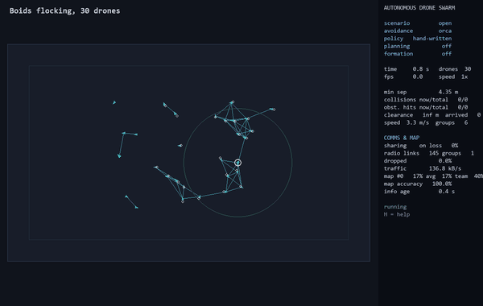 **Boids flocking**: 30 drones, neighbour links shown | 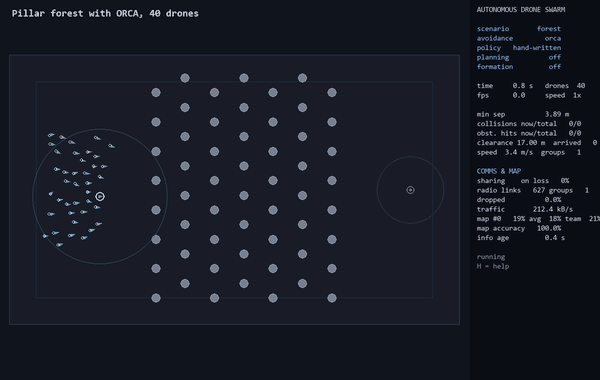 **Pillar forest**: 40 drones, lidar + ORCA, 0 collisions |
| 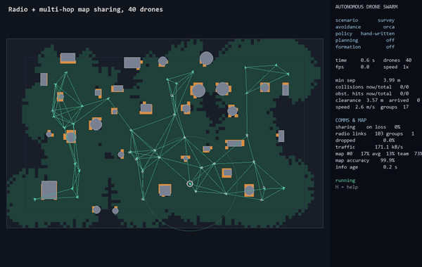 **Shared mapping**: radio links (red = lost packets) and the team's map growing | 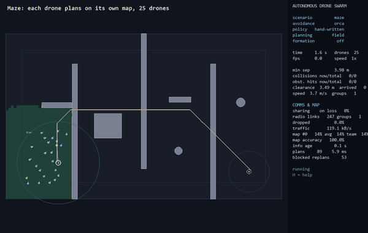 **Maze**: each drone plans on its *own* map and replans when it finds walls |
| 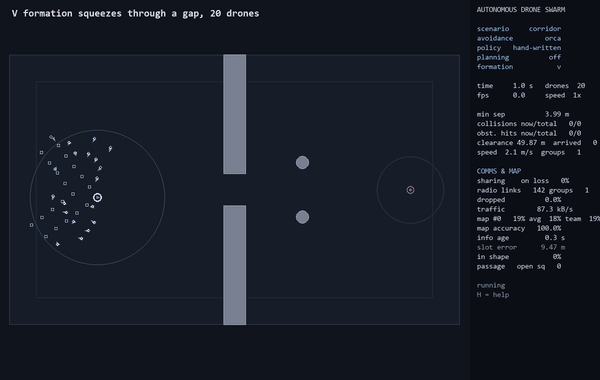 **V formation**: collapses into a column for a 14 m gap, then re-forms | 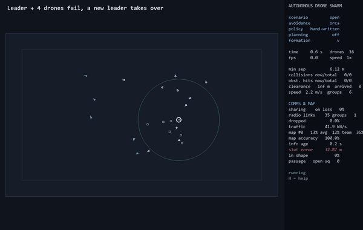 **Leader failure**: the leader and 4 drones fail; a new leader takes over |
| 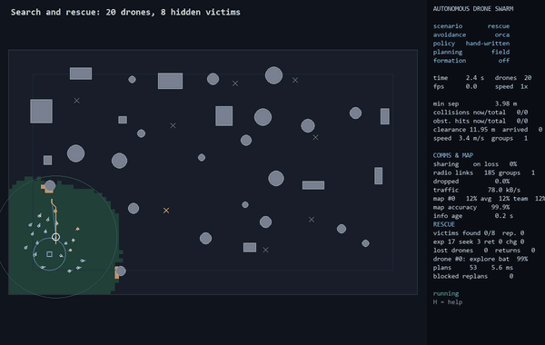 **Search and rescue**: explore, PSO signal search, recharge; 8/8 victims | 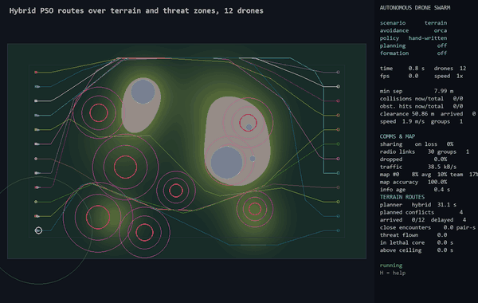 **Terrain**: hybrid-PSO routes around threat zones and peaks |

**What to watch for in each clip**

- **Flocking**: drones start scattered with random headings. Within seconds,
  local groups align and merge into one flock, and nobody touches anybody.
  Every drone only reacts to neighbours within 15 m (the cyan links).
- **Pillar forest**: the swarm squeezes between pillars without slowing to
  a crawl. ORCA picks, for every drone, the closest safe velocity to the one
  it wants.
- **Shared mapping**: green is what the *team* knows. It grows much faster
  than any single drone could explore, because drones relay map pieces
  through each other (multi-hop). Red lines are lost radio packets; it still works.
- **Maze**: the yellow line is one drone's plan on its *own* map. It plans
  straight through unexplored space, then bends the moment it (or a
  teammate, by radio) discovers a wall.
- **Formation through a gap**: the V notices the gap is too narrow,
  becomes a single-file column that follows the leader's exact path, and
  re-forms on the other side.
- **Leader failure**: the leader (pink ring) and 4 others fail and drop
  (red ✕). The lowest surviving id takes over, the V is resized for 11 drones,
  and everyone re-forms behind the new leader.
- **Search and rescue**: dot colours are modes (cyan explore, orange seek,
  yellow return to charge, white charging). Victims turn from grey to found,
  and get a ring once the base has been told.
- **Terrain**: each coloured line is one drone's pre-planned route. They
  avoid peaks (grey) and lethal cores (red); some drones wait a few seconds
  before take-off so they never meet another drone at a crossing.

## Results at a glance

Each line is a measured result (several seeds, see the phase sections for details).

| Phase | Headline result |
|---|---|
| 1 Flocking | 50 drones flock with **0 collisions**, local alignment 0.97 |
| 2 Avoidance | ORCA: **0 collisions and 0 obstacle hits in all 15 runs**; potential fields alone never reach 0 |
| 3 Communication | With multi-hop map sharing each drone knows **85% of the arena after 30 s, vs 17%** alone; still 81% at 50% packet loss |
| 4 Path planning | Flying straight at the goal: **0% escape the maze**; planning: **100%**; shared maps **29% faster** |
| 5 Formations | V / line / box / circle hold to ~0.1–0.7 m in straight flight; through a 14 m gap, a pillar forest and the maze with **nobody left behind** |
| 6 Search and rescue | Full system finds **8/8 victims in every run**; random search 3.7/8; radio off 3.3/8; **0 drones lost** |
| 7 Terrain | Hybrid PSO routes: **0 s in lethal zones** and **4–5× fewer close encounters** than grid routes |
| 8 Reinforcement learning | Learned navigation + ORCA is **~25% faster** than boids + ORCA; on their own, learned policies **are not as safe** as the hand-written ones at 20 drones |
| 9 Robustness | **0 collisions in all 68 stress runs**; rescue finds 8/8 even with **90% packet loss** or **half the swarm failing**; a failed leader is replaced automatically |

## Key results in pictures

The seven figures below carry the main findings. Every number comes from
the benchmark scripts in `experiments/` (several random seeds each); the
figures are rebuilt with `python -m experiments.make_figures`.

### 1. Only ORCA keeps every drone off every obstacle (Phase 2)

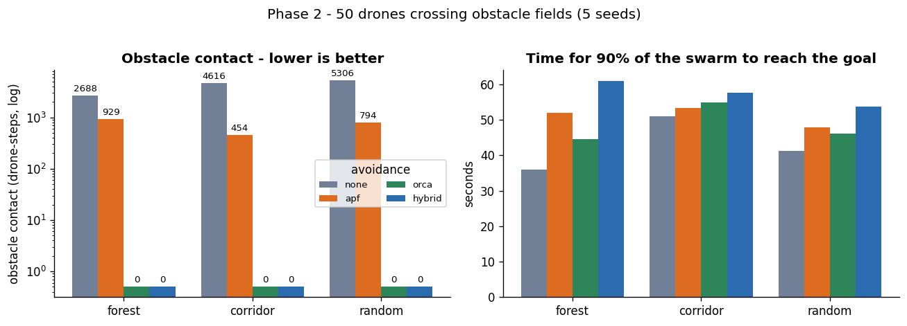

**Setup:** 50 drones fly from the left of the arena to a goal on the right,
through a pillar forest, a wall with one 14 m gap, and a random obstacle field.
Each drone knows about obstacles only through its own 36-beam lidar.

**How to read it:** left is total obstacle contact on a log scale (a bar at
"0" means not a single touch in 5 runs); right is how long the swarm took.

**Takeaway:** without avoidance, drones only get through by scraping along
obstacles (~2,700–5,300 contacts). Potential fields (`apf`) cut that by
80–90% but can never reach zero: in a crowd, neighbours push drones into
pillars. **ORCA reaches exactly zero in every scenario and is the fastest
safe method**, so it's the default. Adding potential fields on top
(`hybrid`) is just as safe, but slower.

### 2. Sharing maps by radio: each drone knows 5× more (Phase 3)

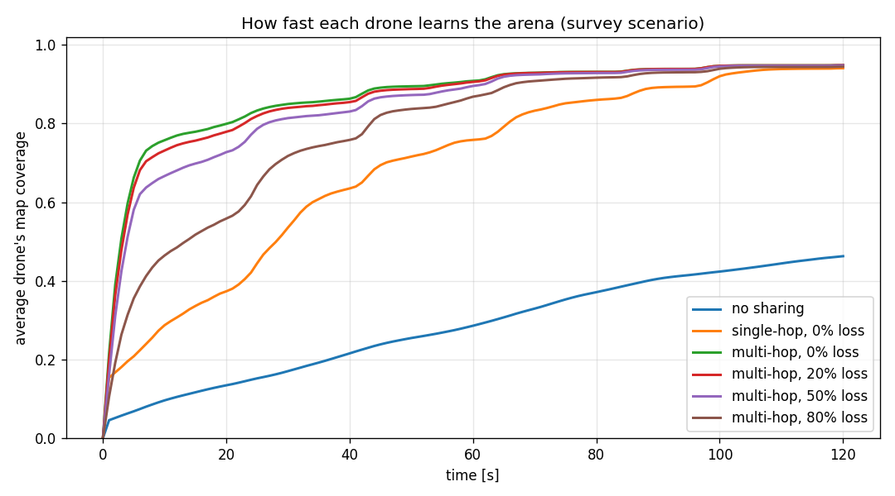

**Setup:** 50 drones scattered over an arena full of obstacles, each building
its *own* map from its own lidar. The curves differ only in what the radio does.

**How to read it:** the y-axis is the share of the arena the *average* drone
has in its own map.

**Takeaway:** alone, a drone knows 17% after 30 s. Sharing with direct
neighbours (single-hop) reaches 54%. **Relaying through the swarm (multi-hop)
reaches 85%**, and still 81% with half of all packets lost. Information
reaches drones that never came anywhere near the area. This is the
"collective intelligence" in numbers.

### 3. In a maze, flying straight at the goal fails; planning on a shared map wins (Phase 4)

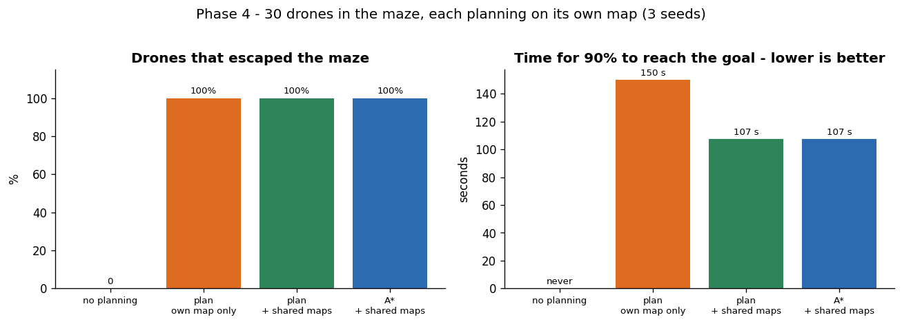

**Setup:** 30 drones must cross an S-shaped maze with a dead-end trap. They
start knowing nothing about it; each plans only on its own map.

**Takeaway:** reactive flight alone (boids + ORCA) is trapped by the first
wall: **0% escape**. With planning, **100%** get through. When drones also
share maps, the ones behind replan around walls the leaders just discovered,
and the swarm finishes **29% sooner**. A\* and the faster cost-field planner
find exactly equally short paths (tests check this).

### 4. Search and rescue: exploring finds most victims, signal search finds the last ones (Phase 6)

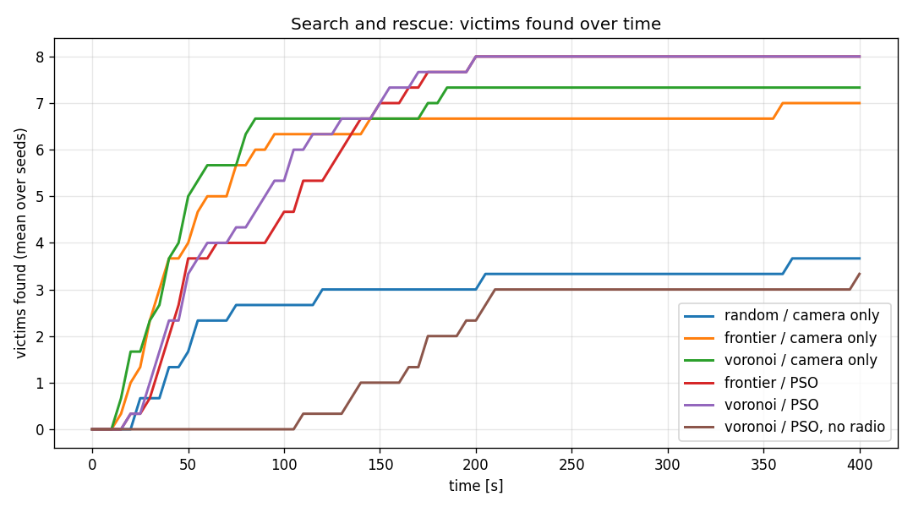

**Setup:** 20 drones, 8 victims hidden among 30 obstacles, 400 s, batteries
that force every drone home to recharge. Each line is one search strategy.

**How to read it:** victims found over time, averaged over 3 runs.

**Takeaway:** random search stalls at ~3.7 victims. Systematic exploration
of the unknown (frontiers) finds ~7. **Only the signal-guided particle swarm
(PSO) finds all 8, in every run.** Mapping an area with a 20 m lidar
isn't the same as passing within 4 m of every spot with a camera. With the
radio off (brown), the same algorithms find only 3.3: drones can no longer
split the area or share where signals are.

### 5. Planning in space *and time*: 4–5× fewer near misses (Phase 7)

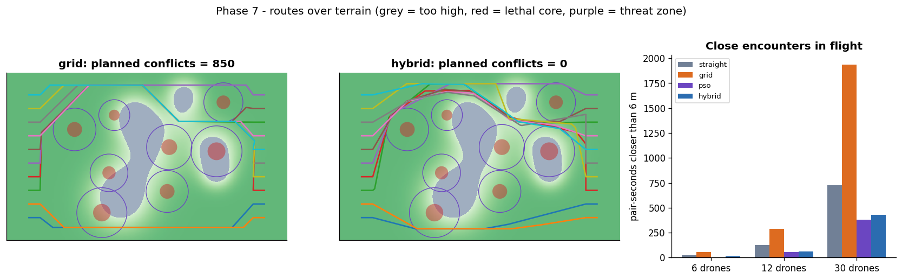

**Setup:** each drone flies from its own start (left) to its own goal
(right, shuffled so routes must cross) over hills, no-fly peaks and threat
zones. Routes are planned before take-off, then flown with ORCA on.

**How to read it:** left, the grid planner's routes: safe, but all funnel
through the same cheapest corridors. Middle, hybrid PSO: same terrain, routes
spread out, some drones wait before take-off, **0 planned conflicts**. Right,
how long pairs of drones actually flew closer than 6 m.

**Takeaway:** hybrid PSO routes never enter a lethal zone and cut close
encounters **4–5× at every swarm size**, so the swarm relies far less on
last-second avoidance. Straight lines (grey) fly straight through lethal zones.

### 6. Learned vs hand-written: RL is fast, ORCA keeps it safe (Phase 8)

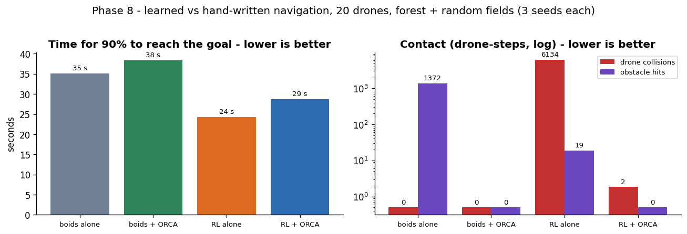

**Setup:** a small neural network shared by every drone, trained with PPO on
a laptop CPU (8 drones, ~25 min), then flown by 20 drones through obstacle
fields, against the hand-written controllers.

**Takeaway:** the learned policy reaches the goal fastest (24 s vs 38 s), but
on its own it collides thousands of times: it learned "go" far better
than "don't touch". **Wrapped in ORCA, it stays ~25% faster than the
hand-written stack with almost no contact.** For flocking, formations and
search, the learned policies did *not* beat the hand-written ones at 20
drones (details in the Phase 8 section).

### 7. Graceful degradation (Phase 9)

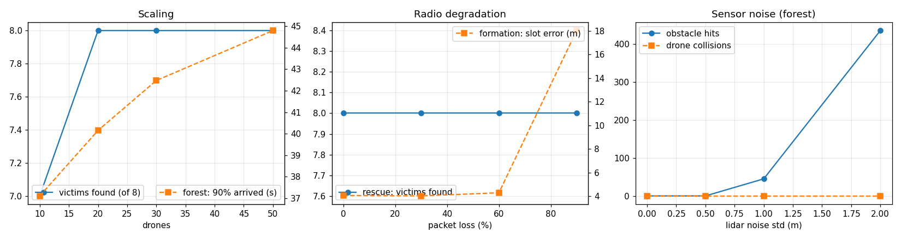

**Setup:** one thing changed at a time from the defaults: swarm size,
radio packet loss, lidar noise.

**Takeaway:** search and rescue finds all 8 victims from 20 to 50 drones
and **even with 90% of radio packets lost**. Formations need their radio:
they hold up to 60% loss, then fall apart. Lidar noise has a clear threshold:
harmless at 0.5 m, then drones start hitting pillars. Drones never hit
*each other*, because they sense each other directly. Not shown: with
**half the rescue swarm failing mid-mission**, all 8 victims are still found.

---

## Table of contents

1. [Project goals](#project-goals)
2. [Current status](#current-status)
3. [Features](#features)
4. [Quick start](#quick-start)
5. [Usage](#usage)
6. [Viewer controls](#viewer-controls)
7. [Configuration](#configuration)
8. [How it works](#how-it-works)
9. [Metrics](#metrics)
10. [Benchmark results](#benchmark-results)
11. [Project structure](#project-structure)
12. [Testing](#testing)
13. [Roadmap](#roadmap)
14. [Algorithms (planned and implemented)](#algorithms)
15. [Hardware and design decisions](#hardware-and-design-decisions)
16. [Development workflow](#development-workflow)
17. [References](#references)

(The Demo and Results at a glance sections are above this list.)

---

## Project goals

| Goal | Description |
|---|---|
| Autonomous obstacle avoidance | Drones sense and steer around static and dynamic obstacles |
| Collision prevention | No drone-to-drone collisions, even with 50 drones in tight spaces |
| Formation flying | Line, V and circle formations that can reshape to pass through gaps |
| Dynamic path planning | Plan routes on a map and replan when new obstacles are discovered |
| Cooperative search and rescue | Split an area between drones, search it, find victims, report and converge |
| Communication | Drones exchange information with limited range, packet loss and latency |
| Learning | Every behaviour gets a hand-written controller **and** a reinforcement-learning policy, compared head to head |

---

## Current status

| Phase | Feature | Status |
|---|---|---|
| 0 | Project setup: config system, seeded fixed-timestep engine, metrics, tests | ✅ Done |
| 1 | Boids flocking + real-time 2D viewer + headless runner with plots | ✅ Done |
| 2 | Obstacles, lidar sensing, APF + ORCA collision avoidance, scenarios, benchmark | ✅ Done |
| 3 | Radio network, per-drone occupancy maps, multi-hop map sharing, benchmark | ✅ Done |
| 4 | Path planning (A* and cost field) on each drone's own map, replanning, maze, benchmark | ✅ Done |
| 5 | Formation flying: 5 shapes, Hungarian slot assignment, leader trail, squeezing through gaps, benchmark | ✅ Done |
| 6 | Search and rescue: frontier + Voronoi exploration, PSO victim search, auction task allocation, batteries, benchmark | ✅ Done |
| 7 | Terrain and threat zones, PSO / hybrid multi-drone route planner with departure delays, benchmark | ✅ Done |
| 8 | Reinforcement learning: shared-policy PPO with a centralised critic, 4 behaviours trained on CPU, benchmark vs hand-written | ✅ Done |
| 9 | Fault injection, robustness experiments (scaling, radio, failures, sensors), demo GIFs | ✅ Done |

---

## Features

### ✅ Implemented

- **Decentralised point-mass drones**: max speed 8 m/s, max acceleration 6 m/s².
  Each drone reacts only to neighbours inside its 15 m perception radius.
- **Boids flocking** (separation, alignment, cohesion) with three improvements:
  - *prioritised acceleration*: collision avoidance always wins over flocking
  - *anticipatory separation*: predicts neighbours 0.6 s ahead
  - *urgency-scaled separation*: gentle far away, full braking near contact
- **Wall avoidance**: soft steering near the arena edge plus hard walls.
- **Shared goal**: click anywhere in the viewer and the swarm flies there.
- **Obstacles** (Phase 2): circles and boxes with exact signed-distance and
  ray-intersection geometry, plus hard physics (drones can't pass through).
- **Onboard lidar** (Phase 2): 36 beams, 20 m range. Drones know about
  obstacles *only* through their own scan; the nearest point of each
  obstacle is extracted from the scan's local minima.
- **Four avoidance methods**, switchable live (Phase 2):
  - `none`: flocking only (baseline)
  - `apf`: artificial potential field from lidar
  - `orca`: Optimal Reciprocal Collision Avoidance safety layer (RVO2 solver port), **default**
  - `hybrid`: APF steering + ORCA safety layer
- **Scenarios** (Phase 2): `open`, `forest` (pillar grid), `corridor`
  (wall with one 14 m gap), `random` (seeded mix of circles and boxes).
- **Avoidance benchmark** (Phase 2): every method × scenario × seed in parallel,
  writing a CSV and a markdown results table.
- **Occupancy-grid map per drone** (Phase 3): 2 m cells, log-odds updates
  from the drone's own lidar, scored against ground truth (99.8%+ accurate).
- **Radio network** (Phase 3): 30 m range, packet loss, latency, a broadcast
  rate and a per-message bandwidth cap. Each drone keeps a beacon table of
  where it believes the others are.
- **Multi-hop map sharing** (Phase 3): drones broadcast newly learned map
  cells plus a random sample of known ones (anti-entropy, so lost packets
  are eventually repaired). Receivers keep the more confident value, so
  information relayed over many hops is never double-counted. Sharing and
  relaying can each be switched off for comparison.
- **`survey` scenario** (Phase 3): obstacles across the whole arena, drones
  start scattered and roam in several flocks, no goal.
- **Communication benchmark** (Phase 3): no sharing vs single-hop vs
  multi-hop at 0/20/50/80% packet loss.
- **Path planning on each drone's own map** (Phase 4): a cost map (blocked /
  inflated / near-obstacle / unknown cells) and two planners:
  - **A\*** with the octile heuristic (pure Python, the textbook algorithm)
  - **cost field** (default): a backward Dijkstra search from the goal (SciPy, in C), the
    quantity D\* Lite maintains. One search gives the best route from *every*
    cell, so a drone that gets pushed off its path re-attaches with a lookup.
    It finds paths exactly as short as A\* (verified by tests) and is about 6× faster.
- **Optimistic replanning** (Phase 4): unknown space is assumed passable;
  drones replan when a cell on their path turns out to be a wall, when their
  map's obstacle layout changes, and every 5 s.
- **Smooth path following** (Phase 4): each drone steers at the farthest point
  on its path it can see within 12 m (online string pulling). ORCA stays on
  as the safety layer.
- **`maze` scenario** (Phase 4): an S-shaped maze with a dead-end trap where flying straight at the goal fails.
- **Planning benchmark** (Phase 4): no planning vs own-map planning vs
  shared-map planning vs A\*.
- **Formation flying** (Phase 5): leader-follower with 5 shapes (`line`,
  `v`, `circle`, `box`, `column`) that scale to 50 drones with ranks,
  nested chevrons and rings. Followers learn the leader's position *and
  velocity* over the radio, with latency, and extrapolate.
- **Optimal slot assignment** (Phase 5): the Hungarian algorithm gives each
  drone a slot so that a shape change moves the swarm the least total distance.
- **Leader breadcrumb trail** (Phase 5): a column places drones along the
  leader's actual flown path, so it bends around corners. A follower whose own
  map shows a wall between it and its slot follows the trail around the wall.
- **Squeezing through gaps** (Phase 5): the leader measures the passage width
  along its route on its own map, switches to a column when the shape won't
  fit, and restores it when there's room again.
- **Formation benchmark** (Phase 5): every shape in the open, V and line
  through the corridor (squeeze on/off), forest, and the maze with planning.
- **Search-and-rescue mission** (Phase 6): the `rescue` scenario hides 8
  victims among obstacles. Each drone runs its own state machine
  (explore → seek → return → charge) using only its own map, sensors and radio.
- **Exploration** (Phase 6): frontier-based (fly to the edge of the unknown on
  my own map), optionally with a dynamic **Voronoi partition** (only take
  frontiers closer to me than to any teammate I know of).
- **Victim search with Particle Swarm Optimization** (Phase 6): victims'
  phones broadcast a noisy signal with an ID. Seekers are PSO particles pulled
  toward their own best reading and the best reading neighbours shared by radio.
- **Task allocation by auction** (Phase 6): at most 3 drones chase each victim,
  and the closest bidders win (bids spread over the radio).
- **Batteries and a charging base** (Phase 6): drones fly home in time
  (1.5× distance plus a reserve), recharge and go back to work.
- **Reporting** (Phase 6): confirmations spread drone-to-drone and reach the base
  station when any drone that knows is within radio range.
- **Rescue benchmark** (Phase 6): 6 strategies, from random search to the full
  system, plus the full system with the radio off.
- **Terrain and threat zones** (Phase 7): a landscape of smooth hills (peaks
  above the 70 m flight ceiling are no-fly and become physical obstacles) and
  circular threat zones (risk grows toward the centre; the inner core is lethal).
- **Multi-drone route planning** (Phase 7), scored by one shared cost (length,
  threat exposure, climbing, sharp turns, forbidden areas, and **time conflicts
  with other drones**):
  - `pso`: Particle Swarm Optimization over waypoints **and a departure delay**
  - `hybrid` (default): PSO seeded with the grid planner's route
  - `grid`: the Phase 4 cost field over a terrain/threat cost grid
  - `straight`: baseline
- **Priority planning** (Phase 7): drones are planned one after another; each
  must avoid where earlier drones will be *at the same moment*, either by taking
  another path or by waiting a few seconds before take-off.
- **Terrain benchmark** (Phase 7): every planner at 6, 12 and 30 drones, planned
  and then flown with ORCA on.
- **Learned policies** (Phase 8): one small neural network (55 → 64 → 64 → 2)
  shared by every drone, each feeding it only its own local observation.
  It's trained with PPO and a centralised critic (the MAPPO idea), for four
  behaviours: navigation with collision avoidance, flocking, formation keeping
  and search. Training runs inside the real simulator on a laptop CPU (4
  behaviours in parallel, ~30 min).
- **Plug-in deployment** (Phase 8): `--policy models/<task>.pt` flies a trained
  policy in any scenario, optionally wrapped in ORCA (`--rl-orca`).
- **Learned-vs-hand-written benchmark** (Phase 8): every behaviour with 20 drones.
- **Fault injection** (Phase 9): drones can fail mid-flight (scheduled by time
  and fraction, or `sim.fail(ids)`). A failed drone lands where it is and goes
  silent: it's no longer sensed by others, its radio and map stop, and it's
  removed from its mission and formation. **A failed formation leader is
  replaced** by the lowest surviving id, and the shape is resized for the
  survivors. Lidar can be made noisy or lose beams.
- **Robustness experiments** (Phase 9): scaling (10–50 drones), radio
  degradation (0–90% packet loss, 15–50 m range), drone failures (25–50% of
  the swarm, the leader) and sensor faults, one factor at a time.
- **Demo** (Phase 9): animated GIFs of every major behaviour, rendered by the
  real viewer offscreen.
- **Fast neighbour search**: KD-tree, roughly N log N cost.
- **Real-time Pygame viewer**: neighbour links, trails, perception circles,
  live stats panel, behaviour weights tunable while running, add or remove drones.
- **Headless mode**: runs without a window and saves trajectory and metric plots
  plus a JSON summary.
- **Reproducible**: the same seed always gives the same run.
- **Test suite**: 15 pytest tests.

### Possible future work

- Moving (dynamic) obstacles
- Incremental D\* Lite (re-using the previous search instead of a full recompute)
- Signals blocked by obstacles; victims that move; charging-pad queueing
  (1 battery death occurred in 2 runs with 30 and with 50 drones, likely pad congestion)
- Formations of 50+ drones (the V broke up in the 50-drone corridor test)
- Distributed leader election by consensus (today: lowest surviving id, known to all)
- 3D flight (altitude as a real dimension rather than a terrain cost)
- RL policies that match the hand-written controllers at 20 drones (needs far
  more training than a CPU laptop gives; see the Phase 8 results)
- Leader-follower and virtual-structure formations with shape switching
- Search and rescue: Voronoi area split, frontier exploration, PSO victim search,
  CBBA/auction task allocation, battery and return-to-base
- Terrain heightmap and threat zones with a PSO multi-drone planner
- PettingZoo multi-agent environment and MAPPO training for every behaviour
- Experiment runner: scaling from 20 to 50 drones, communication loss, drone failures,
  RL vs. classical comparison

---

## Quick start

**Requirements:** Python 3.10+ (developed on 3.12). No GPU needed.

```bash
git clone <repo-url>
cd autonomous-drone-swarm
git checkout development

pip install -r requirements.txt
python -m swarm.main
```

On a machine with little disk space, install with `pip install --no-cache-dir -r requirements.txt`.

---

## Usage

```bash
# Interactive viewer (30 drones by default)
python -m swarm.main

# Choose the number of drones and the random seed
python -m swarm.main --drones 50 --seed 7

# Headless run: no window, writes plots and a summary
python -m swarm.main --headless --drones 50 --steps 3000 --out outputs/run1

# Obstacle scenarios and avoidance methods (Phase 2)
python -m swarm.main --scenario forest --drones 50
python -m swarm.main --scenario corridor --avoidance orca
python -m swarm.main --headless --scenario random --avoidance apf --out outputs/apf_random

# Communication and shared mapping (Phase 3)
python -m swarm.main --scenario survey --drones 50
python -m swarm.main --scenario survey --packet-loss 0.5
python -m swarm.main --headless --scenario survey --no-share --out outputs/noshare
python -m swarm.main --headless --scenario survey --no-relay --out outputs/singlehop

# Path planning (Phase 4)
python -m swarm.main --scenario maze --plan
python -m swarm.main --scenario maze --planner astar
python -m swarm.main --headless --scenario maze --plan --no-share --out outputs/maze_ownmap

# Robustness and demo (Phase 9)
python -m swarm.main --formation v --drones 16 --headless --out outputs/leaderfail   # see faults in YAML
python -m experiments.robustness                                # 68 stress runs (~15 min, all cores)
python -m experiments.robustness --suites failures,radio --seeds 3
python -m experiments.make_demo                                 # GIFs -> outputs/demo/
python -m experiments.make_demo --only rescue,terrain
python -m experiments.make_figures                              # README figures from the benchmark CSVs

# Reinforcement learning (Phase 8)
python -m experiments.train_rl                                  # train all 4 behaviours (~25 min, 4 cores)
python -m experiments.train_rl --init models --drones 20 --samples 800000   # curriculum stage 2
python -m swarm.main --scenario forest --policy models/stage1_8drones/navigate.pt --rl-orca
python -m swarm.main --scenario open --drones 8 --policy models/flock.pt
python -m experiments.benchmark_rl                              # learned vs hand-written, 20 drones

# Terrain and threat zones (Phase 7)
python -m swarm.main --scenario terrain --drones 12
python -m swarm.main --scenario terrain --drones 12 --route-planner grid
python -m swarm.main --headless --scenario terrain --drones 12 --steps 2400 --out outputs/terrain

# Benchmark route planners (writes outputs/benchmarks/terrain.*)
python -m experiments.benchmark_terrain                         # 6/12/30 drones x 3 seeds
python -m experiments.benchmark_terrain --sizes 12 --seeds 2    # quicker

# Search and rescue (Phase 6)
python -m swarm.main --scenario rescue --drones 20
python -m swarm.main --scenario rescue --explore frontier --seek none
python -m swarm.main --headless --scenario rescue --drones 20 --steps 8000 --out outputs/rescue
python -m swarm.main --headless --scenario rescue --no-radio --out outputs/rescue_noradio

# Benchmark search strategies (writes outputs/benchmarks/rescue.*)
python -m experiments.benchmark_rescue                          # 20 drones x 3 seeds x 400 s

# Formation flying (Phase 5)
python -m swarm.main --formation v
python -m swarm.main --scenario corridor --formation v --drones 20
python -m swarm.main --scenario maze --formation v --plan --drones 20
python -m swarm.main --headless --scenario corridor --formation line --no-squeeze --out outputs/line_nosq

# Benchmark formations (writes outputs/benchmarks/formation.*)
python -m experiments.benchmark_formation                       # 20 drones x 3 seeds

# Benchmark planning settings in the maze (writes outputs/benchmarks/planning.*)
python -m experiments.benchmark_planning                        # 30 drones x 3 seeds

# Benchmark communication settings (writes outputs/benchmarks/comms.*)
python -m experiments.benchmark_comms                           # 50 drones x 3 seeds

# Benchmark every avoidance method on every scenario (writes outputs/benchmarks/)
python -m experiments.benchmark_avoidance                       # 50 drones x 5 seeds
python -m experiments.benchmark_avoidance --drones 30 --seeds 3 --steps 1500   # quicker

# Use your own config file
python -m swarm.main --config configs/my_experiment.yaml
```

| Option | Default | Meaning |
|---|---|---|
| `--config` | `configs/default.yaml` | YAML configuration file |
| `--drones` | from config (30) | Number of drones |
| `--seed` | from config (42) | Random seed |
| `--scenario` | from config (`open`) | `open`, `forest`, `corridor`, `random`, `survey`, `maze`, `rescue`, `terrain` |
| `--avoidance` | from config (`orca`) | `none`, `apf`, `orca`, `hybrid` |
| `--packet-loss` | from config (0) | Radio packet loss probability, 0–1 |
| `--comm-range` | from config (30) | Radio range in metres |
| `--no-share` | off | Drones don't share maps |
| `--no-relay` | off | Single-hop radio: no forwarding of others' information |
| `--plan` | off | Each drone plans routes on its own map |
| `--planner` | from config (`field`) | `field` or `astar` (implies `--plan`) |
| `--formation` | off | `line`, `v`, `circle`, `box` or `column` |
| `--no-squeeze` | off | Formation never collapses to a column for gaps |
| `--explore` | from config (`voronoi`) | Rescue: `random`, `frontier` or `voronoi` |
| `--seek` | from config (`pso`) | Rescue: `pso` or `none` (camera only) |
| `--victims` | from config (8) | Rescue: number of victims |
| `--no-radio` | off | Switch the radio off entirely |
| `--route-planner` | from config (`hybrid`) | Terrain: `hybrid`, `pso`, `grid` or `straight` |
| `--policy` | off | Fly a trained policy, e.g. `models/navigate.pt` |
| `--rl-orca` | off | Wrap the trained policy in the ORCA safety layer |
| `--fail-time` / `--fail-fraction` / `--fail-leader` | off | Fail drones at a time (s), what fraction, and whether the leader too |
| `--lidar-noise` / `--lidar-dropout` | 0 | Lidar noise std (m) / probability a beam is lost |
| `--headless` | off | Run without a window |
| `--steps` | from config (3000) | Steps for a headless run (1 step = 0.05 s) |
| `--out` | `outputs/latest` | Output folder for headless results |

A headless run writes:

| File | Contents |
|---|---|
| `trajectories.png` | Every drone's path (■ start, ● end) |
| `metrics.png` | Min separation, polarization, mean speed and groups over time |
| `comms_mapping.png` | Map coverage (team / average / worst drone), accuracy, radio groups and info age over time |
| `summary.json` | Collisions, obstacle hits, clearance, arrivals, alignment, map coverage and accuracy, time to 50% coverage, messages delivered / dropped, traffic, plans / ms per plan / blocked replans, formation error / time in shape / squeezes / leader arrival, victims found / reported and when, drones lost, returns to base, planned and flown route metrics (terrain), run speed |

---

## Viewer controls

| Key / mouse | Action |
|---|---|
| `SPACE` | Pause / resume |
| `.` | Single step (while paused) |
| `1` … `8` | Scenario: open / forest / corridor / random / survey / maze / rescue / terrain |
| `U` | Terrain: cycle the route planner hybrid → pso → grid → straight (replans; shows "Planning routes…") |
| `K` | Path planning on / off (yellow line = selected drone's path, dot = its steering target) |
| `F` | Formation: off → line → V → circle → box → column (pink ring = leader, purple squares = slots, yellow squares = followers on the trail, purple line = leader's trail) |
| `M` | Cycle avoidance method: none → apf → orca → hybrid |
| `V` | Toggle lidar beams (red = hit) |
| Left click | Set a shared goal point |
| Right click | Clear the goal |
| `L` | Links: radio (red = dropped message) → sensing → off |
| `G` | Map overlay: selected drone's map → team map → off |
| `Tab` | Select next drone (white ghosts = where it *believes* the others are) |
| `N` | Map sharing on / off |
| `P` | Packet loss: 0 → 20 → 50 → 80% |
| `C` | Toggle perception circles |
| `T` | Toggle trails |
| `+` / `-` | Add / remove 5 drones |
| `Q` / `A` | Separation weight +0.1 / −0.1 |
| `W` / `S` | Alignment weight +0.1 / −0.1 |
| `E` / `D` | Cohesion weight +0.1 / −0.1 |
| `[` / `]` | Slower / faster simulation |
| `R` | Reset |
| `H` | Show help |
| `ESC` | Quit |

Drone colour shows speed: blue is slow, cyan is cruising, yellow is fast.
The dashed red circle is the goal area; the panel shows how many drones arrived.
In the rescue scenario, each drone has a dot showing its mode: cyan explore, orange
seek, yellow return, white charging, red dead. Victims are marked ✕: grey =
undiscovered, orange = someone hears it, green = found, ringed = reported to the
base (blue square).
In the terrain scenario the background is shaded by height (grey = above the
flight ceiling), threat zones are magenta rings with a red lethal core, and each
drone's planned route is drawn in its own colour from its start (square) to its
goal (circle).
In the map overlay, green cells are known free and orange cells known occupied.
The big circle around the selected drone is its radio range.
Failed drones are drawn as red ✕ and counted in red in the panel, with the new
leader's number after a leader failure.

---

## Configuration

All parameters live in [`configs/default.yaml`](configs/default.yaml). Units are
metres and seconds. Unknown keys raise an error, so typos are caught early.

| Section | Key | Default | Meaning |
|---|---|---|---|
| `sim` | `dt` | 0.05 | Seconds per physics step |
| | `seed` | 42 | Random seed |
| | `steps` | 3000 | Headless run length |
| `world` | `width` × `height` | 200 × 120 | Arena size (m) |
| | `boundary_margin` | 12 | Distance from the wall where drones start turning back |
| `drones` | `count` | 30 | Number of drones |
| | `radius` | 0.5 | Body radius (m); contact happens at 1.0 m |
| | `max_speed` | 8.0 | m/s |
| | `cruise_speed` | 5.0 | Preferred flocking speed |
| | `max_accel` | 6.0 | m/s² |
| | `perception_radius` | 15 | Sensing range |
| | `separation_radius` | 4 | Personal space |
| | `spawn_spacing` | 3 | Minimum distance between drones at start |
| | `spawn_speed` | 0.5 | Drones start near hover |
| `boids` | `separation_weight` | 2.5 | |
| | `alignment_weight` | 1.0 | |
| | `cohesion_weight` | 0.8 | |
| | `boundary_weight` | 3.0 | |
| | `goal_weight` | 1.2 | |
| `sensor` | `num_rays` | 36 | Lidar beams over 360° |
| | `range` | 20 | Lidar range (m) |
| `avoidance` | `method` | orca | `none` / `apf` / `orca` / `hybrid` |
| | `apf_weight` | 1.5 | Potential-field strength |
| | `apf_influence` | 8 | Obstacles closer than this repel (m) |
| | `orca_time_horizon` | 2.0 | Look-ahead for drone–drone constraints (s) |
| | `orca_obstacle_horizon` | 1.5 | Look-ahead for obstacle constraints (s) |
| | `orca_neighbor_dist` | 15 | Drones considered by ORCA (m) |
| | `orca_max_neighbors` | 10 | Max drones per ORCA problem |
| | `safety_margin` | 0.3 | Extra clearance added to the body radius (m) |
| `scenario` | `name` | open | `open` / `forest` / `corridor` / `random` |
| | `goal_radius` | 15 | Drones inside count as arrived (m) |
| | `num_obstacles` | 25 | Random scenario only |
| `mapping` | `enabled` | true | Build occupancy maps |
| | `cell_size` | 2.0 | Grid cell size (m) |
| | `update_interval` | 0.1 | Seconds between lidar → map updates |
| | `l_free` / `l_occ` / `l_max` | −0.4 / 0.85 / 4.0 | Log-odds update and clamp |
| | `known_threshold` | 1.0 | \|log-odds\| above this = cell known |
| `comms` | `enabled` | true | Radio on |
| | `range` | 30 | Radio range (m) |
| | `packet_loss` | 0.0 | Probability each delivery is lost |
| | `latency` | 0.1 | Seconds from send to receive |
| | `broadcast_interval` | 0.25 | Seconds between broadcasts (4 Hz) |
| | `share_maps` | true | Include map cells in messages |
| | `relay` | true | Multi-hop forwarding |
| | `max_cells_per_message` | 300 | Bandwidth cap |
| `planning` | `enabled` | false | Plan routes on each drone's map |
| | `algorithm` | field | `field` (backward Dijkstra) or `astar` |
| | `replan_interval` | 1.0 | Min seconds between replans when the map changed |
| | `refresh_interval` | 5.0 | Full replan at least this often |
| | `unknown_cost` | 0.3 | Extra cost of unknown cells (optimistic planning) |
| | `inflation_cost` | 8.0 | Cost of cells within body radius of an obstacle |
| | `clearance_cost` / `clearance_cells` | 2.0 / 2.0 | Extra cost near obstacles (keeps paths centred) |
| | `lookahead` | 12 | Metres along the path to look for the steering target |
| `formation` | `enabled` | false | Leader-follower formation flying |
| | `shape` | v | `line` / `v` / `circle` / `box` / `column` |
| | `spacing` | 5.0 | Metres between neighbouring slots |
| | `speed` | 3.5 | Leader speed (slower than cruise so followers can catch up) |
| | `gain` | 0.8 | Slot-tracking gain (1/s) |
| | `adaptive` | true | Collapse to a column for narrow passages |
| | `squeeze_lookahead` / `squeeze_margin` | 18 / 2.0 | Metres of route checked, extra width needed per side |
| | `restore_delay` | 2.0 | Seconds the passage must stay wide before restoring |
| | `leader_timeout` | 3.0 | Leader information older than this is ignored (s) |
| | `heading_tau` | 1.5 | Smoothing of the formation heading (s) |
| | `slowdown_error` | 4.0 | Leader slows when followers are this far off-slot (m) |
| `mission` | `enabled` | true | Run the rescue mission (only in scenarios with victims) |
| | `victims` | 8 | Number of victims |
| | `base_x` / `base_y` / `charge_radius` | 20 / 20 / 8 | Base station and charging pad |
| | `use_planner` | true | Navigate with the path planner |
| | `explore` | voronoi | `random` / `frontier` / `voronoi` |
| | `seek` | pso | `pso` or `none` (camera only) |
| | `max_seekers` | 3 | Drones allowed to chase one victim |
| | `signal_range` / `signal_noise` | 45 / 0.01 | Victim signal range (m) and noise |
| | `detect_radius` | 4 | Camera confirmation distance (m) |
| | `explore_speed` / `retarget_interval` | 5.0 / 2.0 | m/s, seconds between target updates |
| | `seek_timeout` | 60 | Give up on a victim after this long (s) |
| | `pso_inertia` / `pso_cognitive` / `pso_social` | 0.6 / 1.2 / 1.6 | PSO coefficients |
| | `pso_max_speed` / `pso_jitter` | 5.0 / 1.0 | PSO speed cap and exploration noise |
| | `battery_capacity` / `drain_hover` / `drain_speed` | 1.0 / 0.0025 / 0.0001 | ~400 s hovering, ~200 s at 5 m/s |
| | `charge_rate` / `reserve` | 0.04 / 0.08 | 25 s to full; reserve kept for the trip home |
| `terrain` | `hills` / `max_height` / `ceiling` | 9 / 100 / 70 | Landscape; ground above the ceiling is no-fly (m) |
| | `threats` / `threat_radius_min` / `threat_radius_max` | 8 / 10 / 20 | Threat zones |
| | `lethal_fraction` | 0.35 | Inner part of a threat zone that must never be entered |
| | `planner` | hybrid | `hybrid` / `pso` / `grid` / `straight` |
| | `waypoints` / `particles` / `iterations` | 6 / 40 / 150 | PSO size |
| | `speed` / `separation` | 5.0 / 6.0 | Used to deconflict routes in time |
| | `w_length` / `w_threat` / `w_climb` / `w_turn` / `w_conflict` / `w_delay` | 1 / 40 / 0.5 / 60 / 50 / 2.5 | Cost weights |
| | `max_delay` / `lane` | 15 / 8 | Longest departure wait (s); straight leg out of start / into goal (m) |
| `faults` | `fail_time` / `fail_fraction` / `fail_leader` | -1 / 0 / false | Drone failures (time −1 = never) |
| | `lidar_noise` / `lidar_dropout` | 0 / 0 | Degraded lidar |
| `rl` | `policy` | "" | Path to a trained policy (empty = hand-written controllers) |
| | `orca` | false | Wrap the learned policy in ORCA |
| `render` | `window_width` × `window_height` | 1200 × 760 | |
| | `fps` | 60 | |
| | `trail_length` | 40 | Frames of trail per drone |
| | `steps_per_frame` | 1 | Simulation speed-up |

---

## How it works

### Simulation loop

```
each step (dt = 0.05 s):
  1. neighbours  = KD-tree query within perception radius
  2. lidar       = 36 beams per drone -> nearest obstacle points
  3. accel       = controller.compute(state, context)    # each drone: local info only
  4. dynamics    = clamp accel -> update velocity -> clamp speed -> update position
  5. physics     = walls + obstacles push drones out (counted as a hit)
  6. metrics     = separation, collisions, hits, clearance, arrivals, alignment
  7. mapping     = every 0.1 s each drone folds its lidar scan into its own map
  8. radio       = every 0.25 s each drone broadcasts; deliveries arrive after latency
  (planning, if on, runs before step 3 and turns the goal into per-drone waypoints;
   formation, if on, then turns the leader's waypoint into a slot for every follower)
```

### Controller interface

Every behaviour, hand-written or learned, implements one method:

```python
class Controller(Protocol):
    def compute(self, state: SwarmState, ctx: StepContext) -> np.ndarray:
        """Return desired acceleration for every drone, shape (N, 2)."""
```

So a trained RL policy is a drop-in replacement for the boids controller, and
the two can be benchmarked under identical conditions.

### Boids with prioritised acceleration

Rules are combined in priority order. Each rule may only use the acceleration
budget that is left after the rules above it (Reynolds 1999):

| Priority | Rule | Behaviour |
|---|---|---|
| 1 | Separation | Steer away from neighbours that are or *will be* (0.6 s ahead) inside personal space |
| 2 | Boundary | Turn back before hitting the arena wall |
| 3 | Goal | Fly to the clicked target, slowing down on arrival |
| 4 | Alignment + cohesion | Match neighbours' heading, drift toward the local centre |
| 5 | Cruise | Hold the preferred speed |

### Obstacle avoidance (Phase 2)

```
  boids (+ APF obstacle force)  --a_nominal-->  ORCA safety layer  --a_safe-->  dynamics
                                                      ^
              neighbours' positions & velocities -----+
              lidar nearest-obstacle points ----------+
```

**APF (artificial potential field).** Each obstacle point the lidar sees
within 8 m pushes the drone away. The push grows quadratically as the gap
shrinks, so distant pillars barely matter. A sideways component makes drones
slide *around* obstacles they're flying into instead of stopping dead. APF is
cheap and smooth but gives **no guarantee**: in a crowd it must trade drone
separation against obstacle clearance, and it can't do both.

**ORCA (Optimal Reciprocal Collision Avoidance).** Each drone turns the
boids output into a preferred velocity, then builds half-plane constraints
on its own next velocity:
- one per nearby drone: "don't collide within 2 s", with each drone taking
  half the effort (reciprocal), so no communication is needed
- one per lidar obstacle point: "approach no faster than gap / 1.5 s", with full
  effort because obstacles don't move

A small 2D linear program (a port of the RVO2 library solver) picks the
allowed velocity closest to the preferred one. If the constraints can't all
be met, it picks the velocity that violates them least.

**Hybrid.** APF steering with ORCA as the safety layer. It is just as safe
as ORCA, but the benchmark showed the extra APF push only slows the swarm
down (15–30% longer to reach the goal) without adding clearance, so **ORCA
alone is the default**.

### Communication and shared mapping (Phase 3)

**Occupancy grid.** Each drone's map is a grid of 2 m cells storing the
log-odds that the cell is occupied. A lidar beam passing through a cell
lowers it (free); a beam ending in a cell raises it (occupied). Values are
clamped so a cell can still change its mind. Drones never see the true map:
ground truth is used only to score them.

**Radio.** Every 0.25 s each drone broadcasts one message to every drone
within 30 m. Each delivery can be lost (`packet_loss`) and arrives after
`latency`. A message carries:
- a **beacon table**: where the sender believes every drone is, with timestamps;
  receivers keep whichever entry is newer
- up to 300 **map cells**: first the ones the sender recently became sure
  about, then a random sample of cells it already knows. The sample is
  *anti-entropy*: without it, a cell whose messages were all lost would never
  be sent again.

**Merging.** A receiver adopts a cell only when the sender is clearly more
confident about it. "More confident wins" can be applied any number of times
with the same result, so information that loops through the network is never
double-counted. Adopted cells are re-broadcast (relay), which is how
knowledge travels **multi-hop** between flocks that are out of direct range.
With `relay` off, drones forward nothing they learned from others.

### Path planning (Phase 4)

```
 own map (Phase 3) --> cost map --> planner (cost field or A*) --> path
                                                                   |
 drone position --> farthest visible point on path (<= 12 m) --> boids goal term --> ORCA --> dynamics
```

**Cost map.** Built from the drone's own log-odds map: known obstacles are
blocked; cells within the drone's body radius of an obstacle are expensive
(×8); cells close to obstacles cost a little extra (keeps paths centred in
corridors); unknown cells cost slightly more than known-free ones. Diagonal
moves may not cut between two blocked cells.

**Planners.**
- **A\*** searches from the drone to the goal with the octile-distance
  heuristic, which never overestimates, so the path is optimal. It's written in
  plain Python to show the algorithm, at ~35 ms per plan.
- **Cost field** (default) runs Dijkstra backwards from the goal using SciPy's
  C implementation, at ~6 ms per plan. The result is the cost-to-go from *every*
  cell. That's the quantity D\* Lite maintains, and it means a drone pushed off
  course just looks up the new best direction. Paths are exactly as short as
  A\*'s.

**Replanning.** The planner assumes unknown space is free ("optimistic").
When the drone, or a teammate via radio, discovers a wall, the map's
obstacle revision counter changes and the drone replans (at most once per
second, staggered across drones). A wall appearing *on* the current path
triggers an immediate replan.

**Path following.** The drone steers at the farthest waypoint within 12 m that it
can see in a straight line on its own map. This turns the staircase grid
path into smooth flight without a separate smoothing step.

### Formation flying (Phase 5)

```
 leader:    goal / planner waypoint / patrol loop --> fly at formation speed (slower if followers lag)
 follower:  leader pos + vel from radio (extrapolated) --> slot = leader + rotate(offset, heading)
            v_desired = v_leader + gain * (slot - position)  --> separation, walls, ORCA as before
```

**Shapes.** Each shape is a list of slot offsets in the leader's frame
(forward = heading). For big swarms they grow sensibly: `line` adds ranks
of 11, `v` nests a new chevron behind the first (5 per arm), `circle` adds
rings, `box` is a square grid. Every slot is at least `spacing` (5 m) from
every other.

**Assignment.** When the shape changes, the leader solves a linear assignment
(Hungarian algorithm, SciPy) between followers and slots, minimising the total
distance flown. A drone that's already close to a slot keeps it.

**Leader trail.** The leader records a breadcrumb every metre it flies. This
path is known to be flyable, so it serves two purposes:
- in a `column`, follower *j* holds the point *j × 5 m* back along the
  trail. The column follows the leader's exact route around corners.
- a follower whose own map shows a wall between it and its slot follows the
  trail instead. It targets the newest breadcrumb it can see, but always at least
  3 m further along than where it is, and rejoins its slot on the far side.

**Squeezing.** The leader measures the passage along its next 18 m of route:
2 × the smallest distance from the route to a known obstacle on its map. If
the shape (plus 2 m each side) doesn't fit, everyone switches to a column. The
shape is restored 2 s after the passage is wide again; drones still in the
gap use the trail to come through.

**What it does not model.** The leader's trail and shape changes reach
followers instantly; in reality they would ride on the radio messages (the
leader's *position and velocity* do go over the radio, with latency and loss).
The leader is fixed (drone 0); leader failure and re-election come in Phase 9.

### Search and rescue (Phase 6)

```
            hears a victim & wins the auction                 victim confirmed / lost auction / timeout
 EXPLORE ---------------------------------------> SEEK ------------------------------------------------> EXPLORE
    |  battery = trip home + reserve                |
    +-------------------> RETURN --> CHARGE --------+--> EXPLORE (full)            battery empty --> DEAD
```

**Exploring.** A *frontier* is a known-free cell on the drone's own map
next to unknown space. Every 2 s an exploring drone picks the nearest
frontier. With `voronoi`, it only considers frontiers closer to itself than
to any teammate in its radio beacon table, which splits the area between
drones without any central planner. Unreachable targets get blacklisted.

**Victim signals.** Each victim's phone broadcasts an ID. Signal strength is
1 / (1 + (d / 10 m)²) plus noise (σ = 0.01): about 0.5 at 10 m and 0.05 at
45 m, where it fades into the noise. A victim is *confirmed* only by camera,
within 4 m.

**PSO seeking.** Seekers are particles. Four times a second:
v ← 0.6 v + 1.2 r₁ (p_best − x) + 1.6 r₂ (g_best − x) + noise.
*p_best* is where this drone measured the strongest signal; *g_best* is the
strongest reading any teammate shared over the radio. Two additions make it
work with only 3 particles and noisy signals: the noise term scales with the
distance the best reading implies (explore widely when far, fine-tune when
close), and if *g_best* hasn't improved for 6 s each particle gets a random
kick (a PSO restart).

**Auction.** A drone wanting a victim bids its distance to the best-known
reading. Bids spread by radio; a drone keeps seeking only while it's among the
3 lowest fresh bids it knows. Only drones that hear the victim, or are within
signal range of its best reading, may bid.

**Batteries.** Drain = 0.0025/s hovering + 0.0001/s per (m/s)². A drone
returns once its battery covers only 1.5× the straight-line trip home plus an
8% reserve, then charges at 4%/s.

**Safety net.** A navigating drone that stays within 2 m of one spot for 8 s
is "stuck": an explorer drops its target; a returning drone backs off toward
open space for 3 s and tries again.

### Terrain and threat zones (Phase 7)

```
 starts, goals, terrain ──> plan every route before take-off (one drone at a time)
                                │  each route: start → 8 m lane → K waypoints → 8 m lane → goal,
                                │  plus a departure delay; cost includes time conflicts
                                ▼  with all routes chosen so far
 fly: each drone waits for its delay, then follows its route (pure pursuit) ──> ORCA ──> dynamics
```

**Terrain.** Ground height is a sum of Gaussian hills, evaluated exactly.
Drones fly a fixed clearance above the ground, so crossing a hill means
climbing. Ground above the 70 m ceiling can't be flown over; each such peak
also becomes a circular obstacle so the lidar and ORCA respect it in flight.

**Threat zones.** Risk = (1 − d/R)² inside a zone of radius R; the inner
35% is lethal and must never be entered.

**Route cost** (the same for every planner). A route is resampled to 400
points and scored on length, ∫ risk, metres climbed, turns sharper than 30°,
the departure delay, and **conflicts**: for every route already chosen, how
far inside 6 m the two drones get *at the same moment*. Entering a lethal
core, flying over ground above the ceiling, or leaving the arena is
forbidden (a huge penalty), enforced with a safety buffer (cores 3 m bigger,
ceiling 5 m lower) because a drone in flight can be pushed a little off its
route. Every drone leaves its start heading east and enters its goal from the
west, so no route runs along the crowded start or goal lines.

**Planners.**
- **PSO**: each particle is a whole route: K = 6 free waypoints plus a
  departure delay (0–15 s). Inertia falls from 0.9 to 0.4. Drones are planned
  in turn, each avoiding the routes before it in space *and time*. Waiting
  costs half as much as flying, so PSO often resolves a conflict by
  delaying take-off rather than taking a long detour.
- **Hybrid** (default): the same PSO, with a few particles started from the
  grid planner's route, which is known to be legal. The swarm then improves it
  (fewer conflicts, smoother turns). PSO keeps its best-ever route, so hybrid is
  never worse than its seed (a test checks this).
- **Grid**: the Phase 4 cost field on a 2 m grid whose cells cost
  length + threat + slope, with forbidden cells blocked. Optimal on its grid,
  then simplified (Douglas–Peucker), but blind to turns and other drones.
- **Straight**: the baseline.

**Flying.** Each drone waits for its departure delay, then steers at a point
8 m ahead on its route. ORCA stays on, so a planned route can never cause a
collision; the benchmark measures how often ORCA has to step in.

### Reinforcement learning (Phase 8)

```
 each drone: own observation (55 numbers) --> shared actor network --> desired velocity --> fixed tracking rule --> acceleration
 training only: [own obs, team-average obs] --> critic network --> value (centralised training, decentralised execution)
```

**Observation** (identical in training and deployment, `swarm/rl/observe.py`):
own velocity; direction and distance to the current target (goal, planner
waypoint or formation slot); the 6 nearest neighbours' relative positions and
velocities; 12 lidar sectors, where the arena edge (geofence) also counts;
and 8 sectors of "still unknown" space from the drone's own map.

**Action:** a desired velocity. A fixed rule turns it into an acceleration,
(v_desired − v) / 0.5 s, within the drone's limits. ORCA can wrap the result
like any other controller.

**Training:** PPO with GAE(λ = 0.95), a clipped objective, 4 epochs per
update and rewards scaled by a running estimate of the return's spread. The
actor and critic have separate optimisers. Every drone's experience trains the
same network (parameter sharing). The critic also sees the team-average
observation, but it's only used during training (the MAPPO idea). Rewards
per behaviour:

| Behaviour | Rewarded for | Penalised for (all behaviours) |
|---|---|---|
| navigate | progress toward the goal, arriving | collisions, near misses, obstacle hits, hugging the arena edge, jerky flight |
| flock | alignment with neighbours, having up to 4 neighbours, cruise speed | ... plus being alone |
| formation | getting closer to the slot behind a scripted leader, being within 1.5 m | ... plus distance from the slot |
| search | newly mapped cells on the drone's own map | |

**Curriculum:** stage 1 trains with 8 drones (navigation starts with 4).
Stage 2 continues every policy with 20 drones; for navigation, half the
episodes give every drone the same goal.

### Fault injection and robustness (Phase 9)

**Failing a drone** (`Simulation.fail(ids)`, or scheduled with
`faults.fail_time` / `fail_fraction` / `fail_leader`): the drone lands where
it is (position frozen, velocity zero) and from then on:
- other drones no longer sense it (it's on the ground)
- its radio is silent (no links, no relaying) and its map stops updating
- the rescue mission marks it dead; the metrics count the flying swarm only
- the formation drops it. If it was the **leader**, the lowest surviving id
  takes over, starts a new trail, and every follower gets a slot in a shape
  resized for the survivors (Hungarian assignment again)

**Degraded lidar** (`faults.lidar_noise`, `lidar_dropout`): Gaussian noise on
every range reading, and a chance that each beam returns nothing. The noisy
scan feeds everything downstream: detections, ORCA, APF and the maps.

**Experiments** change one thing at a time from the defaults (20 drones,
ORCA on, radio on). Rescue missions run 300 s; navigation and formation 120 s.

Lessons from development (found by tests and benchmarks):

- Drones spawned at full speed in random directions collided before they
  could brake, so they now start near hover.
- A "desired minus current velocity" cohesion rule acted as a brake and
  halved flock speed, so it was replaced with a pure pull toward the centre.
- Flocks piled up when turning at walls. Anticipatory separation fixed this.
- *Phase 2:* drones stopped in front of the corridor gap. The cause was a
  raycast bug: a beam parallel to a box edge but outside the box was reported
  as a hit, so drones "saw" a wall inside the gap. Fixed and covered by a test.
- *Phase 2:* the first APF version used "steer away at full speed", which
  braked drones even when passing beside a pillar, so they never reached the
  goal. It was replaced with a true distance-based force.
- *Phase 2:* raycasting every beam against every obstacle took half the step
  time. Testing only obstacles within sensor range made it about 3× faster
  with identical results (verified against brute force).
- *Phase 3:* the first sharing design sent each new map cell once. If that
  message was lost, or nobody was in range, the cell was never shared again.
  Adding anti-entropy (a random sample of known cells per message) fixed it.
- *Phase 3:* in single-hop mode the anti-entropy sample could still forward
  cells learned from others, which is secretly multi-hop. Drones now track which
  cells they observed themselves, and single-hop sends only those.
- *Phase 3:* merging each delivered message separately was slow when a
  tight flock exchanged ~2,500 messages per broadcast. Messages are now
  grouped per receiver and merged in one vectorised pass.
- *Phase 4:* the first planner ran at 22 steps/s with 30 drones. Profiling
  showed the time spread across graph building, path extraction and steering
  point selection. Four fixes (replan only when the obstacle layout changed, a
  fixed neighbour table, vectorised path extraction, building the sparse
  graph directly) doubled it, with identical results.
- *Phase 4:* the first path-extraction code could step diagonally between two
  blocked cells, which the search itself forbids. Extraction now uses exactly
  the search's edges; a test checks every step of every path.
- *Phase 5:* in the maze, followers piled up against walls trying to reach
  slots on the other side. The first fix (follow the drone ahead) failed
  because that drone was stuck too. Following the leader's breadcrumb trail fixed it.
- *Phase 5:* the first gap detector used the lidar cone ahead and mistook a
  wall *in front* for a narrow gap, so the formation flipped between V and column
  11 times in the maze. Measuring the passage along the planned route on the
  leader's map fixed it (1 switch).
- *Phase 5:* followers beside a gap got stuck targeting "the newest trail point
  I can see", which was the one they were standing on, because the wall's
  corner cell hid the rest. Now they always move at least 3 m along the trail.
- *Phase 5:* a rule to restore the shape "once every follower has passed the
  gap" deadlocked when the leader parked less than a column-length past the
  gap. A simple 2 s delay plus the trail fallback works better.
- *Phase 6:* two drones ran out of battery although they turned home in time.
  They were pinned between an obstacle and the arena edge, because the soft
  "stay off the edge" push outranked "fly to target". Mission drones now rank
  their target first; a stuck detector is the safety net.
- *Phase 6:* the first stuck detector ("not getting closer to the target")
  fired ~200 times per run, falsely: targets change every 2 s and planned
  routes often start by moving away. "Hasn't moved 2 m in 8 s" fires 0–3 times.
- *Phase 6:* PSO first found only 2 of 4 victims. Drones 100 m away joined
  searches they couldn't hear, and with weak, noisy signals the particles
  stalled. Restricting who may join, distance-scaled exploration noise and
  restart kicks fixed it (4 of 4 on every seed tried).
- *Phase 6:* the viewer froze when the selected drone had no waypoint:
  pygame loops forever when asked to draw at NaN coordinates. Fixed, with a
  regression test that runs the draw in a subprocess with a timeout.
- *Phase 7:* pure PSO sometimes left a route grazing a no-fly peak, and in
  flight a drone was pushed 1.4 s into a lethal core while dodging another.
  Planning with safety buffers and seeding PSO from the grid route (hybrid)
  fixed both.
- *Phase 7:* evaluating the terrain analytically millions of times made
  planning slow (24 s for 12 drones). Pre-computed height/risk tables on a
  0.5 m grid made it 3.6× faster; the lookup error (< 3 m) is inside the 5 m
  ceiling buffer.
- *Phase 7:* with path-only PSO, the last-planned drones took huge detours
  (one route was 648 m for a 170 m trip) to dodge everyone before them. Adding a
  departure delay to each particle fixed it: waiting a few seconds beats a loop.
- *Phase 7:* a test found that a route's score depended on which other routes
  it was scored *alongside* (the sample count followed the longest route in the
  batch), so PSO could keep a route that was illegal on its own. Every route now
  gets the same fixed 400 samples.
- *Phase 7:* drones got stuck in the column of drones already parked at their
  goals. Two fixes: conflicts are only excused when *both* drones are near their
  own endpoints (flying past a parked drone counts), and PSO waypoints stay
  between the start and goal lanes.
- *Phase 8:* the first training run got *worse* over time. The actor and critic
  shared one gradient clip, so the critic's huge value-error gradients shrank
  the actor's updates to almost nothing. Separate optimisers and reward
  scaling fixed it, and a pure-maths toy task (now a test) confirmed PPO learns.
- *Phase 8:* with accelerations as actions, every task was also a momentum
  control problem and nothing learned in the CPU budget. Desired-velocity
  actions made formation and search learn.
- *Phase 8:* navigation, flocking and search still went backwards: drones were
  penalised for hugging the arena edge, which they couldn't perceive (the lidar
  only sees obstacles). Adding the geofence to the lidar sectors fixed it.
- *Phase 8:* policies trained with 8 drones worked at 8 (the flocking policy
  matched boids: 0 collisions, alignment 0.99) but fell apart at 20, where the
  swarm is much denser. A second curriculum stage at 20 drones helped flocking
  during training, but made navigation worse (see the results).
- *Phase 9:* the first demo GIFs were 44 MB: every frame had its own dithered
  palette, which GIF compression handles badly. One shared palette (sampled
  across the whole run) and no dithering cut that to 13 MB at full size and
  4 MB for the half-size README copies.
- *Phase 9:* after drone failures, the radio-group count jumped, because every
  landed drone counted as an isolated group of one. Failed drones are now
  excluded.

---

## Metrics

| Metric | Meaning | Good value |
|---|---|---|
| `min_separation` | Closest distance between any two drones (m) | > 1.0 (contact distance) |
| `collisions` | Pairs currently overlapping | 0 |
| `mean_speed` | Average speed (m/s) | Near cruise speed |
| `polarization` | Global heading alignment, 0 (random) to 1 (all the same) | High when there is one flock |
| `local_polarization` | How aligned each drone is with its own neighbours | > 0.9 for a healthy flock |
| `groups` | Connected components of the perception graph | 1 = one swarm |
| `obstacle_hits` | Drones touching an obstacle this step | 0 |
| `min_clearance` | Smallest gap between a drone's body and an obstacle (m) | > 0 |
| `arrived` | Drones inside the goal radius | all |
| `time_to_90pct_arrived` | Seconds until 90% of the swarm reached the goal | lower is better |
| `map_coverage_mean` / `min` / `team` | Fraction of the arena known by the average drone / the least-informed drone / the whole team | higher is better |
| `map_accuracy` | Known cells classified correctly (vs ground truth) | > 99% |
| `comm_links` / `comm_groups` | Radio links in range / connected radio groups | 1 group = everyone reachable |
| `teammates_known` / `info_age` | How many teammates each drone knows about, and how old that information is (s) | |
| `delivered` / `dropped` / `kbytes_sent` | Radio traffic | |
| `plans` / `plan_ms_mean` / `blocked_replans` | Planner activity and cost | |
| `formation_error_mean` | Average distance of followers from their slots (m) | low |
| `formation_in_shape` | Share of time the average slot error is below 2.5 m | high |
| `formation_squeezes` | Times the formation collapsed to a column for a gap | |
| `leader_arrived` | When the leader reached the goal (a formation is wider than the goal circle) | |
| `victims_found` / `victims_reported` | Victims confirmed by camera / known at the base | all |
| `victim_found_times` / `all_reported` | When each victim was found; when the base knew them all | lower is better |
| `drones_lost` | Drones whose battery ran out | 0 |
| `returns_to_base` / `stuck_recoveries` | Recharging trips; times the stuck detector intervened | |
| `planned_forbidden_m` / `planned_conflict` | Terrain: metres of forbidden flight and time-conflict score in the plan | 0 / low |
| `close_encounter_pair_s` | Terrain: seconds that pairs of drones spent closer than 6 m en route | low |
| `flown_threat` / `flown_lethal_s` / `flown_above_ceiling_s` | Terrain: what the drones actually flew through | low / 0 / 0 |
| `policy` / `policy_with_orca` | Which trained policy flew, and whether ORCA wrapped it | |
| `alive` | Drones still flying (after failures) | |

Planned metrics for later phases:
messages sent, path length, formation error, energy use.

---

## Benchmark results

Phase 1, 3000 steps (150 s simulated) per run, 5 seeds per swarm size:

| Drones | Collisions | Closest approach | Local alignment | Sim speed |
|---|---|---|---|---|
| 20 | **0** | ≥ 1.57 m | 0.97–0.99 | ~680 steps/s |
| 30 | **0** | ≥ 1.51 m | 0.97–0.98 | ~630 steps/s |
| 50 | **0** | ≥ 1.55 m | 0.97–0.98 | ~500 steps/s |

~500 steps/s is about **25× real time** on an Intel i5-8365U laptop with no GPU.

### Phase 2: avoidance benchmark

50 drones, 5 seeds per row, 2400 steps (120 s simulated) per run. Drones
start on the left and must reach the goal on the right.
Reproduce with `python -m experiments.benchmark_avoidance`.

| Scenario | Method | Runs with no contact at all | Drone collisions (avg) | Obstacle hits (avg) | Min clearance (m) | Arrived | Time for 90% to arrive (s) |
|---|---|---|---|---|---|---|---|
| forest | none | 0/5 | 4.2 | 2688 | touching | 98% | 36.0 |
| forest | apf | 0/5 | 0 | 929 | touching | 99% | 51.9 |
| forest | **orca** | **5/5** | **0** | **0** | 0.30 | 98% | **44.6** |
| forest | hybrid | 5/5 | 0 | 0 | 0.32 | 98% | 61.0 |
| corridor | none | 0/5 | 0 | 4616 | touching | 99% | 51.1 |
| corridor | apf | 0/5 | 0 | 454 | touching | 98% | 53.4 |
| corridor | **orca** | **5/5** | **0** | **0** | 0.28 | 98% | **54.8** |
| corridor | hybrid | 5/5 | 0 | 0 | 0.30 | 99% | 57.6 |
| random | none | 0/5 | 0 | 5306 | touching | 96% | 41.3 |
| random | apf | 0/5 | 0 | 794 | touching | 99% | 47.8 |
| random | **orca** | **5/5** | **0** | **0** | 0.28 | 96% | **46.1** |
| random | hybrid | 5/5 | 0 | 0 | 0.30 | 97% | 53.7 |

Hits and collisions are counted in drone-steps (one touch lasting 5 steps
counts as 5).

What the numbers show:
- **none** is fastest only because hard physics lets drones scrape along
  obstacles, with thousands of contacts.
- **apf** cuts contacts by 80–90% but never reaches zero: in a crowd, neighbours
  push drones into obstacles. This is the classic weakness of potential fields.
- **orca** gives zero contacts in all 15 runs and is the fastest safe method.
  It keeps exactly the 0.3 m safety margin it is configured for.
- **hybrid** is equally safe but slower. The minimum clearance is the same
  because ORCA, not APF, decides the closest approaches.
- 96–99% arrival rather than 100%: the last 1–2 drones are usually squeezed
  out of the crowded goal circle, not stuck.

### Phase 3: communication benchmark

`survey` scenario, 50 drones, 3 seeds per row, 120 s simulated. Coverage is
the fraction of the arena a drone has classified in its **own** map.
Reproduce with `python -m experiments.benchmark_comms`.

| Setting | Average drone's map at 30 s | Time to 50% | Time to 80% | Time to 90% | Final: average / worst drone | Map accuracy | Traffic |
|---|---|---|---|---|---|---|---|
| no sharing | 17% | 119 s (2 of 3 runs) | never | never | 46% / 31% | 99.8% | 199 kB/s |
| single-hop, 0% loss | 54% | 36 s | 62 s | 69 s | 94% / 58% | 99.9% | 64 kB/s |
| **multi-hop, 0% loss** | **85%** | **3 s** | **20 s** | **49 s** | 95% / 90% | 99.8% | 264 kB/s |
| multi-hop, 20% loss | 84% | 4 s | 24 s | 51 s | 95% / 89% | 99.9% | 264 kB/s |
| multi-hop, 50% loss | 81% | 4 s | 40 s | 57 s | 95% / 86% | 99.9% | 264 kB/s |
| multi-hop, 80% loss | 72% | 16 s | 44 s | 61 s | 94% / 70% | 99.9% | 265 kB/s |

All 18 runs: 0 drone collisions, 0 obstacle hits.

What the numbers show:
- **Sharing is the difference between 17% and 85%** of the arena known per drone after 30 s.
- **Relaying matters as much as sharing**: single-hop drones only learn from
  their own flock, so the worst drone ends at 58% vs 90% with multi-hop.
- **The swarm tolerates heavy packet loss.** 50% loss costs little, because
  the same information arrives by many paths and anti-entropy repairs gaps.
  Only at 80% loss does it slow down noticeably, and every setting still ends
  above 94%.
- **Traffic** is about 5.3 kB/s per drone with multi-hop sharing (≈ 42 kbit/s),
  within reach of common low-power drone radios. "No sharing" still sends
  beacon tables, which is why it isn't zero. (Re-measured in Phase 5, when
  beacons gained the sender's velocity: 20 bytes per entry instead of 12.
  Coverage results were unchanged.)

### Phase 4: planning benchmark

`maze` scenario, 30 drones, 3 seeds per row, 200 s simulated.
Reproduce with `python -m experiments.benchmark_planning`.

| Setting | Arrived | Time for 90% to arrive | Drone collisions | Obstacle hits | ms per plan | Sim speed |
|---|---|---|---|---|---|---|
| no planning (straight at goal) | **0%** | never | 0 | 0 | n/a | 104 steps/s |
| plan, own map only | 100% | 150 s | 0 | 0 | 5.3 | 71 steps/s |
| **plan + shared maps** | **100%** | **107 s** | 0 | 0 | 5.6 | 52 steps/s |
| A\* + shared maps | 100% | 107 s | 0 | 0 | 36.9 | 24 steps/s |

What the numbers show:
- **Without planning the swarm never escapes the first wall.** Boids + ORCA
  head straight for the goal and get trapped in the local minimum.
- **Planning solves the maze every time**, with no collisions or hits, even
  though every drone starts knowing nothing about the maze.
- **Shared maps make the swarm 29% faster** (107 s vs 150 s): when the front
  drones discover a wall, the drones behind replan before they reach it.
- **A\* and the cost field give the same result** (same arrival time; tests
  prove equal path costs), but the cost field is about 6× cheaper per plan.

### Phase 5: formation benchmark

20 drones, 3 seeds per row. *Open* has no goal: the leader flies a
rectangular patrol loop for 120 s, including four 90° turns. "Left behind"
means a follower more than 20 m from its slot (or from its point on the
leader's trail, in a column) at the end.
Reproduce with `python -m experiments.benchmark_formation`.

| Case | Mean slot error | Time in shape (< 2.5 m) | Squeezes | Leader reached goal | Left behind | Collisions | Obstacle hits |
|---|---|---|---|---|---|---|---|
| open / line | 5.2 m | 62% | 0 | n/a (patrol) | 0 | 0 | 0 |
| open / v | 4.2 m | 69% | 0 | n/a (patrol) | 0 | 0 | 0 |
| open / circle | 4.8 m | 59% | 0 | n/a (patrol) | 0 | 0 | 0 |
| open / box | 3.9 m | 68% | 0 | n/a (patrol) | 0 | 0 | 0 |
| corridor / free flocking | n/a | n/a | 0 | 33 s | 0 | 0 | 0 |
| corridor / v, squeeze on | 5.3 m | 66% | 1 | 74 s | 0 | 0 | 0 |
| corridor / v, squeeze off | 3.5 m | 67% | 0 | 72 s | 0 | 0 | 0 |
| corridor / line, squeeze on | 6.6 m | 61% | 1 | 77 s | 0 | 0 | 0 |
| forest / v | 5.5 m | 66% | 1 | 70 s | 0 | 0 | 0 |
| maze / v + planning | 4.1 m | 61% | 1.3 | 178 s | 0.3 | 0 | 0 |

All 30 runs: 0 drone collisions, 0 obstacle hits.

What the numbers show:
- **Formations hold.** In straight flight followers sit within ~0.1–0.7 m of
  their slots. The averages above include assembling from random starts and
  the patrol's 90° turns, where a rigid shape must swing round.
- **Every formation gets through every obstacle course**: a 14 m gap, a pillar
  forest and the maze, with nobody left behind except one drone in one maze run.
- **Squeezing is not essential here**: with it off, the V still gets through
  the corridor gap (the trail fallback carries the blocked wing through) and
  keeps a lower average error. Squeezing gives an orderly single-file
  passage instead.
- **The price of keeping shape is speed**: free flocking reaches the goal in
  33 s, a formation in ~72 s. The leader flies at 3.5 m/s instead of 5 m/s and
  waits for stragglers.
- **The maze stays a column all the way**: a 20-drone V needs 45 m and the
  maze sections are ~46 m, just short of the 47 m needed to restore. That's the
  intended behaviour.

### Phase 6: search-and-rescue benchmark

`rescue` scenario: 20 drones start at the base; 8 victims are hidden among 30
obstacles; 3 seeds per row; 400 s missions with batteries that force every
drone home at least once. Mean time to find counts an unfound victim as found
at 400 s (a lower bound). Reproduce with `python -m experiments.benchmark_rescue`.

| Strategy | Victims found | Mean time to find | All 8 found | All reported to base | Map coverage | Drones lost |
|---|---|---|---|---|---|---|
| random / camera only | 3.7 / 8 | 259 s | never | never | 58% | 0 |
| frontier / camera only | 7.0 / 8 | 105 s | 1 of 3 runs | 1 of 3 runs | 96% | 0 |
| voronoi / camera only | 7.3 / 8 | 82 s | 1 of 3 runs | 1 of 3 runs | 96% | 0 |
| frontier / PSO | **8 / 8** | 86 s | 156 s | 220 s | 95% | 0 |
| **voronoi / PSO** (full system) | **8 / 8** | **80 s** | 159 s | 219 s | 96% | 0 |
| voronoi / PSO, **no radio** | 3.3 / 8 | 312 s | never | never | 44% | 0 |

All 18 missions: 0 drones lost, 0 collisions, 0 obstacle hits.

What the numbers show:
- **Coordinated exploration is worth 2×**: frontier exploration finds about
  twice as many victims as random search, 4× faster on average.
- **Signal-guided PSO is what finds the *last* victims**: camera-only
  strategies actually find the first ~6 victims slightly *faster* (they don't
  stop to chase signals), but they plateau at ~7 of 8. Mapping 96% of the
  arena with a 20 m lidar is not the same as flying within 4 m of every spot
  with a camera. With PSO the swarm finds all 8 in every run.
- **Voronoi partitioning helps a little**: 80 s vs 86 s mean time with PSO,
  82 s vs 105 s camera only. Small next to the other effects, with 3 seeds.
- **The radio is the single most important component**: switching it off
  drops the full system from 8 to 3.3 victims. Drones can no longer split the
  area, share where signals are, or report anything until they fly home.
- **Batteries were never a problem**: every drone went home and recharged,
  and none were lost.

### Phase 7: terrain route-planning benchmark

`terrain` scenario: 9 hills (some above the flight ceiling), 8 threat zones;
drones start on the left and their goals on the right are **shuffled**, so
routes must cross. 3 seeds per row; planned, then flown for 120 s with ORCA on.
"Close encounters" = seconds that pairs of drones spent closer than 6 m en route.
Reproduce with `python -m experiments.benchmark_terrain`.

| Drones | Planner | Planning | Forbidden planned | Planned conflicts | Close encounters flown | Lethal core flown | Arrived | Last arrival |
|---|---|---|---|---|---|---|---|---|
| 6 | straight | 0.3 s | 175 m | 196 | 21 pair-s | **8.5 s** | 100% | 44 s |
| 6 | grid | 0.3 s | 0 | 359 | 56 pair-s | 0 | 100% | 47 s |
| 6 | pso | 8.5 s | 0 | 0 | 3 pair-s | 0 | 100% | 50 s |
| 6 | **hybrid** | 8.2 s | **0** | **0** | 15 pair-s | **0** | 100% | 46 s |
| 12 | straight | 0.2 s | 443 m | 1,425 | 125 pair-s | **26 s** | 100% | 47 s |
| 12 | grid | 0.3 s | 0 | 3,177 | 289 pair-s | 0 | 100% | 50 s |
| 12 | pso | 22 s | 8 m | 10 | 57 pair-s | 0 | 100% | 65 s |
| 12 | **hybrid** | 21 s | **0** | 29 | **61 pair-s** | **0** | 100% | 52 s |
| 30 | straight | 0.2 s | 982 m | 9,452 | 724 pair-s | **51 s** | 98% | 51 s |
| 30 | grid | 0.4 s | 0 | 32,433 | 1,936 pair-s | 0 | 100% | 62 s |
| 30 | pso | 82 s | 78 m | 507 | 379 pair-s | 0 | 100% | 76 s |
| 30 | **hybrid** | 64 s | **0** | 716 | **427 pair-s** | **0** | 100% | 73 s |

All 36 runs: 0 drone collisions, 0 obstacle hits.

What the numbers show:
- **Straight lines are deadly**: they cross lethal cores and no-fly peaks,
  and drones spend up to 51 s inside lethal cores.
- **The grid planner is safe and fast but blind to the other drones**:
  every route funnels through the same cheapest corridors at the same time,
  so ORCA has to resolve ~1,900 pair-seconds of close encounters at 30 drones.
- **Hybrid gives 4–5× fewer close encounters than grid** at every size, is
  legal in every run, and every drone arrives. The price: 2–11 s later
  arrival (longer routes and departure delays) and up to a minute of planning
  for 30 drones.
- **Pure PSO is not reliable on its own**: at 12 and 30 drones some planned
  routes still clip forbidden areas. Seeding it with the grid route (hybrid)
  removes that while keeping PSO's deconfliction.
- **Why close encounters matter when there were no collisions anyway**:
  ORCA caught every one of them. Planned deconfliction means the swarm
  depends far less on last-second avoidance, which matters if a sensor, the
  radio or ORCA itself ever fails (Phase 9 tests exactly that).

### Phase 8: learned policies vs hand-written controllers

Every behaviour flown by **20 drones**, 3 seeds per row, 120 s (search 60 s).
"Stage 1" policies were trained with 8 drones (~1–2 M samples, 24 min for
all four in parallel); "stage 2" continued them with 20 drones (+0.8 M
samples each, 7 min). Collisions are drone-steps in contact.
Reproduce with `python -m experiments.benchmark_rl --models <folder>`.

**Navigation** (forest and random obstacle fields, every drone to the same goal):

| Controller | Arrived (forest / random) | Time for 90% to arrive | Drone collisions | Obstacle hits |
|---|---|---|---|---|
| boids, no avoidance | 100% / 98% | 34 / 36 s | 0 | 1,101 / 1,643 |
| **boids + ORCA** (hand-written default) | 100% / 98% | 40 / 37 s | **0** | **0** |
| RL alone, stage 1 | 93% / 98% | **25 / 23 s** | 5,869 / 6,399 | 32 / 6 |
| **RL + ORCA, stage 1** | 97% / 97% | **31 / 26 s** | 1.7 / 2.0 | **0** |
| RL alone, stage 2 | 67% / 67% | 55 / 84 s | 1,732 / 1,844 | 21 / 10 |
| RL + ORCA, stage 2 | 72% / 58% | 53 / 51 s | 0 | 0 |

**Flocking, formation and search** (stage 1 / stage 2 policies):

| Behaviour | Hand-written | RL stage 1 | RL stage 2 |
|---|---|---|---|
| flock: local alignment, speed, collisions | 0.98, 4.2 m/s, **0** | 0.15, 0.0 m/s, 235,557 | 0.81, 1.2 m/s, 30,696 |
| formation (V): slot error, collisions | **4.2 m**, 0 | 12.4 m, 641 | 14.2 m, 328 |
| search: average drone's map after 60 s, collisions | 89%, **0** | **91%**, 82 | 88%, 98 |

What the numbers show:
- **The learned navigation policy is faster but not safe on its own.** It gets
  20 drones to the goal ~35% faster than boids + ORCA, but with thousands of
  collision steps: it learned "go" much better than "don't touch".
- **Learned speed + hand-written safety is the useful combination.** With
  ORCA wrapping it, the stage-1 policy still arrives ~20–30% faster than
  boids + ORCA, with ~2 collision steps in 120 s and no obstacle hits.
- **Flocking learned at the training size but didn't scale.** With 8 drones
  the policy matches boids (alignment 0.99, 0 collisions); with 20 it
  collapses, and in the 120 s run the drones stop and pile up. Stage 2 helped
  but nowhere near enough.
- **Search learned the most:** the learned explorers map as much as
  flocking with map sharing (91% vs 89%), from nothing but "new cells are
  good", but they still bump into each other.
- **Formation learned to follow, not to hold a shape**: 3× the
  hand-written error.
- **The second curriculum stage made navigation worse.** The shared-goal
  episodes probably taught a crowd behaviour that doesn't transfer. Stage-1
  policies are kept in `models/stage1_8drones/`.
- **Bottom line**: with about an hour of CPU training, hand-written
  controllers remain better and safer for every behaviour at 20 drones. RL's
  real strength showed up as raw navigation speed. Closing the gap would take
  much more training (tens of millions of samples), longer training episodes,
  and probably a neighbour-count-independent network (e.g. a graph network);
  a free Colab or Kaggle GPU would be the practical next step.

### Phase 9: robustness experiments

One factor changed at a time from the defaults (20 drones, ORCA, radio on);
2 seeds per row; rescue 300 s, navigation and formation 120 s.
Reproduce with `python -m experiments.robustness`.


**Scaling**

| Drones | Forest navigation: 90% arrived by | V through corridor: time in shape / left behind | Rescue: victims found / all reported by | Sim speed (rescue) |
|---|---|---|---|---|
| 10 | 37 s | 87% / 0 | 7.0 / 225 s (1 of 2 runs) | 58 steps/s |
| 20 | 40 s | 64% / 0 | **8.0** / 216 s | 31 steps/s |
| 30 | 42 s | 49% / 0 | **8.0** / 223 s | 23 steps/s |
| 50 | 45 s | **2% / 21.5** | **8.0** / 205 s | 13 steps/s |

**Radio degradation**

| Setting | Rescue: victims found / all reported by | V formation: mean slot error / time in shape |
|---|---|---|
| 0% packet loss | 8.0 / 216 s | 4.1 m / 69% |
| 30% loss | 8.0 / 222 s | 4.0 m / 70% |
| 60% loss | 8.0 / 214 s | 4.3 m / 66% |
| 90% loss | **8.0** / 228 s | **18.0 m / 37%** |
| 15 m radio range | 8.0 / 226 s | |
| 50 m radio range | 8.0 / **162 s** | |

**Drone failures**

| Case | Result |
|---|---|
| Rescue, 25% of drones fail at 60 s | **8/8** found and reported (205 s), 15 drones flying |
| Rescue, 50% fail at 60 s | **8/8** found and reported (240 s vs 216 s), 10 drones flying |
| V formation, leader + 25% fail at 20 s | **1 re-election**, time in shape 60% (vs 69% without failures), nobody left behind |
| Forest navigation, 30% fail at 10 s | 100% of the survivors arrive, 0 collisions |

**Sensor faults** (forest navigation)

| Lidar | 90% arrived by | Obstacle hits | Drone collisions |
|---|---|---|---|
| perfect | 40 s | 0 | 0 |
| noise σ = 0.5 m | 46 s | 0 | 0 |
| noise σ = 1 m | 49 s | **45** | 0 |
| noise σ = 2 m | 49 s | **436** | 0 |
| 30% beams lost | 43 s | 0 | 0 |
| 60% beams lost | 46 s | 0 | 0 |

**0 drone collisions in all 68 runs.**

What the numbers show:
- **Navigation and rescue scale to 50 drones.** Rescue saturates at 20
  drones (8/8); more drones only make it slightly faster. The simulator slows
  to ~13 steps/s with 50 rescue drones (still about 0.65× real time on a laptop).
- **Big formations don't scale here**: a 50-drone V through the corridor
  falls apart (a 245 m column can't re-form within 120 s). Up to 30 drones works.
- **The rescue mission barely notices radio problems**: all 8 victims are
  found even at 90% packet loss or with a 15 m range, because messages
  are repeated and relayed. A longer range helps (all reported 54 s sooner).
- **The formation needs its radio**: followers beyond sensing range track the
  leader via radio beacons. Up to 60% loss is fine; at 90% the mean slot
  error quadruples.
- **The swarm survives losing half its drones**: the rescue still finds and
  reports every victim, only 24 s later. A formation that loses its leader
  elects a new one and re-forms.
- **Noisy range readings are worse than missing ones**: losing 60% of lidar
  beams is harmless (the remaining beams still see the pillars), but 1 m of
  noise makes pillars look closer or farther than they are, and drones hit
  them. Drone-to-drone safety is unaffected because drones sense each other
  directly, not through the lidar.

---

## Project structure

```
autonomous-drone-swarm/
├── configs/
│   └── default.yaml          all tunable parameters
├── swarm/
│   ├── main.py               command-line entry point
│   ├── config.py             typed YAML config loader
│   ├── mathutil.py           vectorised 2D vector helpers
│   ├── metrics.py            swarm metrics
│   ├── agents/
│   │   ├── state.py          swarm state (positions, velocities, ids), spawning
│   │   └── sensors.py        lidar range sensor, nearest-obstacle detections
│   ├── mapping/
│   │   └── occupancy.py      per-drone log-odds grids, merging, ground truth
│   ├── comms/
│   │   └── network.py        radio model, beacon tables, message delivery
│   ├── planning/
│   │   ├── grid.py           cost map, A*, backward-Dijkstra cost field, path extraction
│   │   └── planner.py        per-drone replanning and string-pulling path following
│   ├── rl/
│   │   ├── observe.py        55-number local observation, desired-velocity actions
│   │   ├── env.py            training tasks and rewards on the real simulator
│   │   ├── ppo.py            shared-policy PPO with a centralised critic
│   │   └── controller.py     flying a trained policy as a normal controller
│   ├── terrain/
│   │   ├── terrain.py        hills, threat zones, no-fly peaks, lookup tables
│   │   ├── route_cost.py     shared route cost incl. time conflicts
│   │   ├── route_planner.py  PSO / hybrid / grid / straight multi-drone planners
│   │   └── follow.py         flying the planned routes, flown-route metrics
│   ├── mission/
│   │   ├── victims.py        victims and their noisy radio signal
│   │   ├── manager.py        state machine, exploration, PSO, auction, batteries, gossip
│   │   └── controller.py     velocity-tracking controller for mission drones
│   ├── formation/
│   │   ├── shapes.py         slot offsets for line / v / circle / box / column
│   │   ├── manager.py        leader, Hungarian assignment, trail, squeezing, slot targets
│   │   └── controller.py     slot-tracking controller (reuses boids safety terms)
│   ├── sim/
│   │   ├── world.py          arena, walls, obstacles
│   │   ├── obstacles.py      circle/box geometry: distance, raycast, collision
│   │   ├── scenarios.py      open / forest / corridor / random / survey / maze / rescue / terrain
│   │   ├── dynamics.py       point-mass integration with limits
│   │   ├── neighbors.py      KD-tree neighbour queries
│   │   └── engine.py         simulation loop, recorder
│   ├── control/
│   │   ├── base.py           Controller interface, StepContext
│   │   ├── boids.py          boids controller (+ APF obstacle term)
│   │   ├── orca.py           ORCA safety layer and 2D LP solver
│   │   └── factory.py        builds none / apf / orca / hybrid stacks
│   └── viz/
│       ├── render2d.py       Pygame real-time viewer
│       └── plots.py          Matplotlib trajectory and metric plots
├── experiments/
│   ├── benchmark_avoidance.py   method x scenario x seed comparison
│   ├── benchmark_comms.py       sharing / relay / packet-loss comparison
│   ├── benchmark_planning.py    planning on/off, own vs shared map, A* vs field
│   ├── benchmark_formation.py   shapes, squeezing, obstacle courses
│   ├── benchmark_rescue.py      search strategies, with and without radio
│   ├── benchmark_terrain.py     route planners at 6 / 12 / 30 drones
│   ├── train_rl.py              train the 4 policies in parallel (curriculum)
│   ├── benchmark_rl.py          learned vs hand-written, 20 drones
│   ├── robustness.py            scaling / radio / failure / sensor stress tests
│   ├── make_figures.py          key result figures -> docs/figures/
│   └── make_demo.py             demo GIFs from the real viewer
├── docs/
│   ├── PLAN.md               roadmap
│   ├── figures/              key result figures used in this README
│   └── demo/                 half-size demo GIFs used in this README (~4 MB)
├── models/                   trained policies (stage 2) + logs and learning curves
│   └── stage1_8drones/       stage-1 policies (8 drones), best for navigation
├── tests/
│   ├── test_core.py          Phase 0-1 tests
│   ├── test_phase2.py        Phase 2 tests
│   ├── test_phase3.py        Phase 3 tests
│   ├── test_phase4.py        Phase 4 tests
│   ├── test_phase5.py        Phase 5 tests
│   ├── test_phase6.py        Phase 6 tests
│   ├── test_phase7.py        Phase 7 tests
│   ├── test_phase8.py        Phase 8 tests
│   └── test_phase9.py        Phase 9 tests
├── requirements.txt
└── pytest.ini
```


---

## Testing

```bash
python -m pytest            # 189 tests, ~4 min
python -m pytest -v         # verbose
```

The tests cover:
- vector maths, config loading and rejection of unknown keys
- dynamics limits and walls
- spawn spacing
- each boids rule individually
- determinism (same seed gives the same result)
- full 20- and 50-drone flights: zero collisions, the flock aligns and keeps
  flying, every drone stays in bounds
- adding and removing drones
- an offscreen viewer smoke test
- *Phase 2:* signed distance and raycasting against known answers and a
  brute-force reference, plus a regression test for the parallel-beam bug
- *Phase 2:* lidar nearest-point detection, the APF direction, and the LP solver
  (unconstrained and constrained cases)
- *Phase 2:* ORCA: two drones flying head-on never touch; a drone aimed at a
  wall stops before it
- *Phase 2:* every scenario has an obstacle-free spawn area and goal
- *Phase 2:* end to end, 30 drones cross the forest and the corridor with 0 collisions,
  0 obstacle hits and ≥ 90% arrived; the CLI headless run and viewer key handling also work
- *Phase 3:* lidar marks free space and walls correctly, never cells behind a
  wall; values stay clamped; a sweep maps a known world at > 97% accuracy
- *Phase 3:* merge rules: the more confident value wins, merging is idempotent,
  and duplicates keep the strongest value; messages send new cells first, then
  a refresh sample; single-hop sends only self-observed cells
- *Phase 3:* radio: in range → heard, out of range → never; 100% loss
  delivers nothing; latency delays delivery exactly; positions **and** map
  cells cross A → B → C only when relay is on
- *Phase 3:* end to end: sharing raises every drone's coverage by > 30 points;
  radio randomness never changes how drones fly; adding or removing drones
  resizes maps and radio; config, CLI and viewer keys all work
- *Phase 4:* cost map layers; A\* goes straight in open space, around walls,
  returns nothing when unreachable and never cuts corners
- *Phase 4:* the cost field is 0 at the goal and infinite inside a closed box;
  on 6 random maps it finds paths **exactly** as cheap as A\*
- *Phase 4:* the obstacle revision counter changes only when the obstacle
  layout changes; a wall appearing on a drone's path triggers a replan
  that avoids it; steering targets never cross a known obstacle
- *Phase 4:* end to end, in the maze 15 drones without planning all get stuck,
  while with planning ≥ 14 arrive, with 0 collisions and 0 hits; CLI and viewer work
- *Phase 5:* every shape at every size has exactly N slots, the leader at the
  origin and ≥ 5 m spacing; the frame rotates with heading; Hungarian
  assignment puts drones back on the slots they already occupy
- *Phase 5:* trail points follow an L-shaped flown path around its corner and
  extend straight back past its start; per-follower errors are measured
  against slots or trail points; passage width matches a known corridor;
  line-of-sight detects walls; beacons carry velocity
- *Phase 5:* end to end, a V holds its shape in open flight; a V squeezes
  through the corridor gap and re-forms with nobody left behind; with
  squeezing off, the trail fallback still gets everyone through; followers
  that lose the leader fall back to flocking; shape switching, CLI and viewer
  key all work
- *Phase 6:* signal strength falls off with distance, stops at range and is
  noisy; the rescue layout keeps victims clear of obstacles and the base
- *Phase 6:* gossip merges confirmations (OR), best readings (max, never
  overwritten by weaker ones) and bids (newest); dead drones don't gossip; the
  auction keeps exactly the 3 lowest fresh bidders
- *Phase 6:* a drone returns when its battery reaches the trip-home threshold,
  charges to full and resumes; an empty battery means dead
- *Phase 6:* frontiers lie on the border of explored space; with Voronoi a
  drone takes the frontier on its own side; the planner handles different
  goals per drone (and "no goal")
- *Phase 6:* end to end, 12 drones find and report ≥ 3 of 4 victims with none
  lost and 0 collisions; without radio only drones at the base report; the
  viewer no longer hangs on NaN; CLI flags work
- *Phase 7:* hill height and threat risk at known points; lethal cores and
  buffers; the no-fly circle edge sits exactly at the ceiling; lookup tables
  match the exact terrain; starts and goals are always safe
- *Phase 7:* route resampling, timed positions with departure delays, the
  cost forbidding lethal cores, conflicts counted only at the same moment
  (take-off side by side excused, flying past a parked drone not)
- *Phase 7:* PSO finds a safe route and its best cost never increases;
  hybrid is never worse than its grid seed; grid routes are legal and
  simplified; hybrid deconflicts better than grid
- *Phase 7:* end to end, drones fly their hybrid routes with 0 time in lethal
  cores, 0 collisions and everyone arriving; drones wait for their departure
  slot; straight routes are flagged as dangerous; CLI and viewer keys work
- *Phase 8:* observation layout (velocity, clipped target, nearest
  neighbours first, empty lidar, geofence), map sectors, velocity commands
  turned into bounded accelerations
- *Phase 8:* every training task steps with finite rewards; moving toward the
  goal earns more than moving away; the formation leader is scripted and not
  trained; collisions are penalised
- *Phase 8:* PPO runs, a saved policy reloads to identical actions, and PPO
  clearly learns a trivial toy task
- *Phase 8:* every policy flies inside the normal simulator; with ORCA a policy
  never collides; the `--policy` / `--rl-orca` CLI flags work
- *Phase 9:* failed drones land, stay put, vanish from sensing, radio and
  metrics, and their maps freeze; scheduled failures hit the right number of
  drones (sparing the leader unless asked); a formation re-elects its leader,
  resizes its shape and re-forms; rescue marks failed drones dead
- *Phase 9:* lidar noise and dropout change the scan, and "no faults"
  changes nothing; the viewer draws failed drones; a demo GIF is written; a
  robustness case runs end to end

---

## Roadmap

Full details are in [docs/PLAN.md](docs/PLAN.md).

| # | Phase | What will be built | Status |
|---|---|---|---|
| 0 | Setup | Config, engine, metrics, tests | ✅ |
| 1 | Boids | Flocking with 20–50 drones, viewer, plots | ✅ |
| 2 | Obstacles and avoidance | Obstacles, lidar, APF, ORCA safety layer, hybrid, forest / corridor / random scenarios, benchmark | ✅ |
| 3 | Communication | Radio with range / loss / latency / bandwidth, beacon tables, per-drone occupancy maps, multi-hop sharing, benchmark | ✅ |
| 4 | Path planning | Cost map, A\*, backward-Dijkstra cost field, optimistic replanning, string-pulling path following, maze, benchmark | ✅ |
| 5 | Formation flying | Leader-follower with 5 shapes, Hungarian slot assignment, leader trail, squeezing through gaps, benchmark | ✅ |
| 6 | Search and rescue | Frontier + Voronoi exploration, PSO victim search, auction task allocation, batteries and charging, radio reporting, benchmark | ✅ |
| 7 | Terrain and threats | Hills and no-fly peaks, threat zones, shared route cost with time conflicts, PSO / hybrid / grid planners, departure delays, benchmark | ✅ |
| 8 | Reinforcement learning | Shared-policy PPO with centralised critic, 4 behaviours, 2-stage curriculum, deployment as a controller, benchmark vs hand-written | ✅ |
| 9 | Experiments and demo | Fault injection, leader re-election, scaling / radio / failure / sensor experiments, demo GIFs | ✅ |

---

## Algorithms

| Algorithm | Used for | Status |
|---|---|---|
| Boids (Reynolds) | Flocking | ✅ |
| Prioritised acceleration allocation | Combining behaviours safely | ✅ |
| KD-tree neighbour search | Fast local sensing | ✅ |
| Ray casting (circle + slab intersection) | Lidar simulation | ✅ |
| Artificial potential fields | Obstacle avoidance baseline | ✅ |
| ORCA / velocity obstacles + 2D linear programming | Drone–drone and drone–obstacle collision prevention | ✅ |
| Log-odds occupancy-grid mapping | Each drone's own map | ✅ |
| Gossip / epidemic dissemination with anti-entropy | Multi-hop map and position sharing | ✅ |
| A\* (octile heuristic) | Path planning, reference implementation | ✅ |
| Backward Dijkstra cost-to-go field (the quantity D\* Lite maintains) | Fast per-drone planning and re-attachment | ✅ |
| Line-of-sight string pulling | Smooth path following | ✅ |
| Incremental D\* Lite | Re-using previous searches | 📋 |
| Leader-follower slot tracking (feed-forward + proportional) | Formation keeping | ✅ |
| Hungarian algorithm (linear assignment) | Optimal slot assignment on shape changes | ✅ |
| Breadcrumb trail following | Columns around corners, recovering blocked followers | ✅ |
| Distance transform along the planned route | Passage-width estimate for squeezing | ✅ |
| Frontier-based exploration | Area search on each drone's own map | ✅ |
| Dynamic Voronoi partitioning | Splitting the search area between drones | ✅ |
| Particle Swarm Optimization (local-best, with restarts) | Signal-guided victim search | ✅ |
| Consensus auction (simplified CBBA, one task per drone) | Assigning drones to victims | ✅ |
| Gossip (OR / max / newest merges) | Spreading confirmations, readings and bids | ✅ |
| PSO route planning (waypoints + departure delay) | Multi-drone paths over terrain and threats | ✅ |
| Prioritised planning with space-time conflict costs | Deconflicting the swarm's routes | ✅ |
| Hybrid PSO seeded with a grid search | Reliable, legal, deconflicted routes | ✅ |
| Douglas–Peucker simplification | Turning grid paths into a few waypoints | ✅ |
| Pure-pursuit path following | Flying the planned routes | ✅ |
| PPO with a centralised critic (MAPPO-style), parameter sharing | Learned policies for 4 behaviours | ✅ |
| GAE(λ), reward scaling, curriculum learning | Making CPU training work | ✅ |

---

## Hardware and design decisions

| Decision | Reason |
|---|---|
| **2D world** | All algorithms carry over to 3D later; much faster to build, train and debug |
| **Point-mass dynamics** | Enough realism for swarm algorithms without quadrotor complexity |
| **Python instead of Unity** | The development laptop (i5-8365U, 16 GB RAM, Intel UHD 620, no CUDA GPU, very little free disk) can't run Unity well; Python also gives native PyTorch for RL |
| **Vectorised NumPy** | 50 drones simulate at ~25× real time on a laptop CPU |
| **One controller interface** | Hand-written and RL controllers are interchangeable and comparable |

### RL on a CPU-only laptop (Phase 8 plan)

- Small policy networks (< 100k parameters) shared by all drones
- Training without rendering, in a vectorised environment
- Curriculum: start with 5–10 drones, then scale to 50
- One behaviour at a time, warm-started from earlier checkpoints
- Free Google Colab / Kaggle GPUs for runs that take too long

---

## Development workflow

- `main`: stable releases
- `development`: active work (all phases are built here)
- Every phase must pass the full test suite and a multi-seed headless
  benchmark before it is committed.

---

## References

- C. Reynolds, *Flocks, Herds, and Schools: A Distributed Behavioral Model*, SIGGRAPH 1987
- C. Reynolds, *Steering Behaviors for Autonomous Characters*, GDC 1999
- R. Olfati-Saber, *Flocking for Multi-Agent Dynamic Systems*, IEEE TAC 2006
- S. Thrun, W. Burgard, D. Fox, *Probabilistic Robotics* (occupancy grid mapping, ch. 9), MIT Press 2005
- A. Demers et al., *Epidemic Algorithms for Replicated Database Maintenance* (gossip, anti-entropy), PODC 1987
- O. Khatib, *Real-Time Obstacle Avoidance for Manipulators and Mobile Robots* (potential fields), IJRR 1986
- J. van den Berg et al., *Reciprocal n-Body Collision Avoidance (ORCA)*, ISRR 2011
- RVO2 Library (reference ORCA implementation), UNC Chapel Hill
- P. Hart, N. Nilsson, B. Raphael, *A Formal Basis for the Heuristic Determination of Minimum Cost Paths* (A\*), IEEE TSSC 1968
- E. Dijkstra, *A Note on Two Problems in Connexion with Graphs*, Numerische Mathematik 1959
- S. Koenig & M. Likhachev, *D\* Lite*, AAAI 2002
- W. Ren & R. Beard, *Distributed Consensus in Multi-Vehicle Cooperative Control*, 2008
- J. Desai, J. Ostrowski, V. Kumar, *Modeling and Control of Formations of Nonholonomic Mobile Robots* (leader-follower), IEEE TRA 2001
- H. Kuhn, *The Hungarian Method for the Assignment Problem*, Naval Research Logistics 1955
- J. Kennedy & R. Eberhart, *Particle Swarm Optimization*, ICNN 1995
- Y. Shi & R. Eberhart, *A Modified Particle Swarm Optimizer* (decreasing inertia weight), IEEE ICEC 1998
- V. Roberge, M. Tarbouchi, G. Labonté, *Comparison of Parallel Genetic Algorithm and Particle Swarm Optimization for Real-Time UAV Path Planning*, IEEE TII 2013
- M. Erdmann & T. Lozano-Pérez, *On Multiple Moving Objects* (prioritised planning), Algorithmica 1987
- D. Douglas & T. Peucker, *Algorithms for the Reduction of the Number of Points Required to Represent a Digitized Line*, Cartographica 1973
- B. Yamauchi, *A Frontier-Based Approach for Autonomous Exploration*, CIRA 1997
- J. Cortés et al., *Coverage Control for Mobile Sensing Networks*, IEEE TRA 2004
- H.-L. Choi et al., *Consensus-Based Decentralized Auctions (CBBA)*, IEEE TRO 2009
- C. Yu et al., *The Surprising Effectiveness of PPO in Cooperative Multi-Agent Games (MAPPO)*, NeurIPS 2022
- J. Schulman et al., *Proximal Policy Optimization Algorithms*, arXiv 2017
- J. Schulman et al., *High-Dimensional Continuous Control Using Generalized Advantage Estimation*, ICLR 2016
- S. Huang et al., *The 37 Implementation Details of Proximal Policy Optimization*, ICLR Blog Track 2022

---

**Author:** Thilina Samarasinghe
